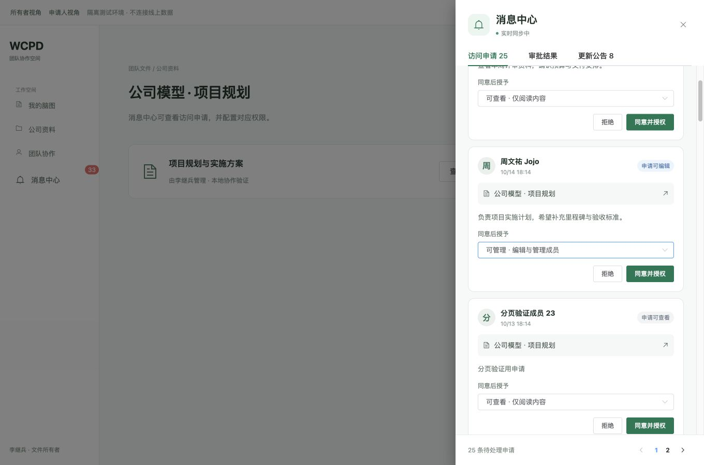
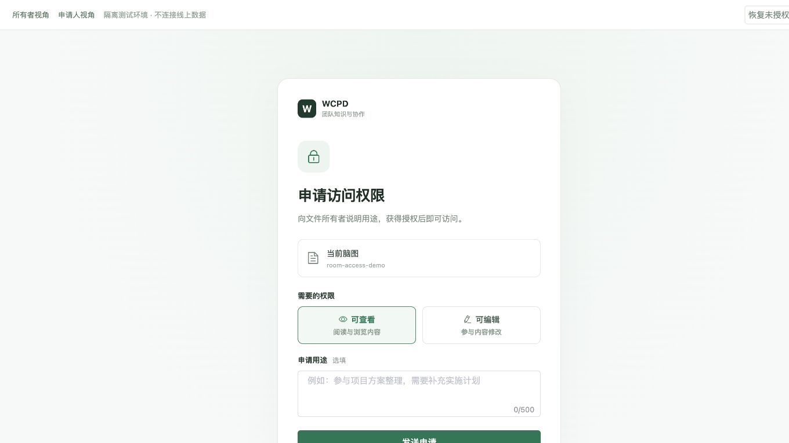
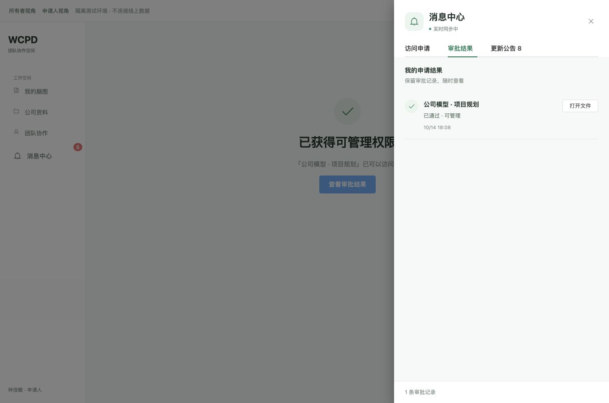
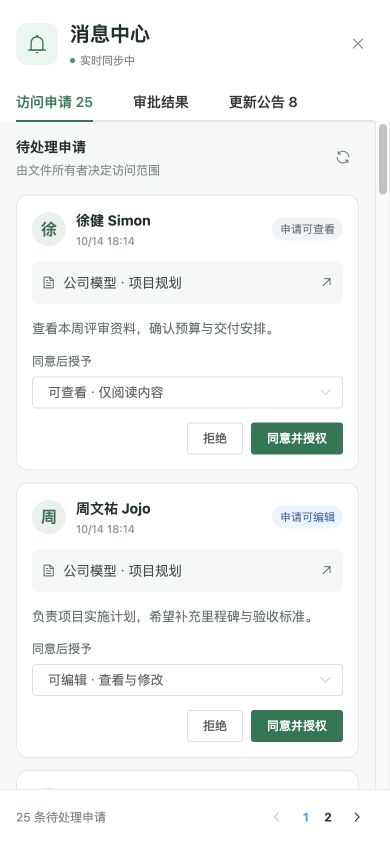
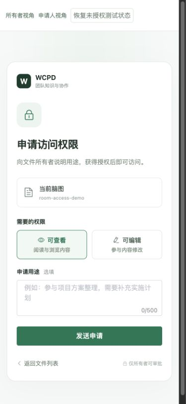

# 访问申请、站内通知与权限审批验收

日期：2026-10-14。在 `fix/permission-dialog-experience` 上继续完善现有脑图访问申请，消息渠道为用户确认的站内消息与实时提醒。

## 行为

- 所有者在线时收到实时站内提醒；申请持久保存，离线、刷新或断线重连后仍能从消息中心读取。消息中心在文件列表侧栏可打开，在脑图编辑页面有独立消息按钮。
- 审批显示申请人、文件、申请用途和申请权限。所有者可以选择可查看、可编辑、可管理后同意，也可以填写原因后拒绝。不能通过审批授予所有者权限。
- 申请人收到实际授予的权限或拒绝原因；授权成功后，无权限页面自动重新打开文件。历史审批通过但后来权限被撤销时允许重新申请，避免无限刷新。
- 审批结果持久保存并支持已读状态；原有更新公告保留，未读公告与待审批数量分开显示。
- 消息按页读取，默认每页 20 条。断线后自动重连，页面恢复前台和低频轮询作为补偿。相同申请不重复创建；同一提醒刷新、重连后不会反复弹出。提醒每类最多保留一个，账号切换时清理旧账号的消息和连接。
- 授权与审批状态更新在同一 PostgreSQL 事务中完成。并发处理、重试、所有权变化、无效角色和已删除文件有后端校验。

## 验证

| 检查 | 结果 |
| --- | --- |
| 双浏览器视角：申请提交 → 所有者实时提醒 → 选择可管理 → 申请人实际获得可管理 | 通过 |
| 窄屏：申请可编辑 → 所有者同意 → 申请人实时获得可编辑 | 通过 |
| 拒绝原因实时回传、重新申请、撤销权限后的状态 | 通过 |
| 通知断线后自动重连、消息补偿读取 | 通过 |
| 25 条申请分页：第一页 20 条、第二页 5 条 | 通过 |
| 审批结果显示实际授予角色，打开后更新未读数量 | 通过 |
| 桌面、390×844 审批抽屉、375×812 申请页面 | 通过，无横向溢出 |
| PostgreSQL：离线申请、重复提交、无关账号隔离、自定义角色、并发审批、幂等重试、失败回滚、已读隔离、所有权转移、删除文件 | 通过 |
| 真实协作服务 HTTP：会话 Cookie 验证、匿名请求/订阅拒绝、非所有者审批拒绝、所有者授权后文件接口 403→200、申请结果和已读 | 通过 |
| 前端状态：过期响应隔离、账号切换、连接恢复、消息去重、分页、资源清理 | 通过 |
| 原有权限弹窗、roomAcl、fileSystem、teamSpace 回归 | 通过 |
| 改动前端文件和脚本 ESLint、生产构建 | 通过，构建保留已有体积提示 |

浏览器验证使用真实生产组件、生产 service、申请/ACL 业务代码、PostgreSQL 和 SSE。浏览器夹具仅在隔离测试环境映射两个测试身份；另有真实协作服务进程验证 Cookie 会话和正式 HTTP 路由。测试会话由脚本写入专用测试库，未调用企业微信扫码登录，也未发送企业微信消息。未修改线上权限、未部署。

实时通道只发送“数据已变化”的信号；申请详情仍通过当前登录用户的鉴权接口读取。每个服务进程共享一个 PostgreSQL LISTEN 连接，支持跨进程通知，不对脑图树做序列化或广播。

## 复现

仓库根目录：

```sh
node web/scripts/verifyAccessNotificationState.cjs
node web/scripts/verifyPermissionDialog.cjs
node simple-mind-map/test/roomAcl.test.js
node simple-mind-map/test/fileSystem.test.js
node simple-mind-map/test/teamSpace.test.js
# 仅对显式指定的可丢弃测试数据库运行：
PERMISSION_TEST_DISPOSABLE=1 PGHOST=127.0.0.1 PGPORT=15439 PGDATABASE=mindmap_preview PGUSER=preview PGPASSWORD=preview-local MIND_MAP_SKIP_ROOT_ENV=1 node scripts/verifyAccessRequests.cjs
PERMISSION_TEST_DISPOSABLE=1 PGHOST=127.0.0.1 PGPORT=15439 PGDATABASE=mindmap_preview PGUSER=preview PGPASSWORD=preview-local MIND_MAP_SKIP_ROOT_ENV=1 node scripts/verifyAccessRequestHttp.cjs
ACCESS_DEMO_MANY_REQUESTS=1 PERMISSION_TEST_DISPOSABLE=1 PGHOST=127.0.0.1 PGPORT=15439 PGDATABASE=mindmap_preview PGUSER=preview PGPASSWORD=preview-local MIND_MAP_SKIP_ROOT_ENV=1 node web/scripts/accessRequestDemo.cjs
```

预览：`http://127.0.0.1:4323/owner` 与 `http://127.0.0.1:4323/applicant`。夹具只监听本地，使用独立测试 schema，退出时清理。正式服务重启时会自动补齐申请原因、实际授权角色、审批原因、已读字段及索引，无需手工修改已有申请。










