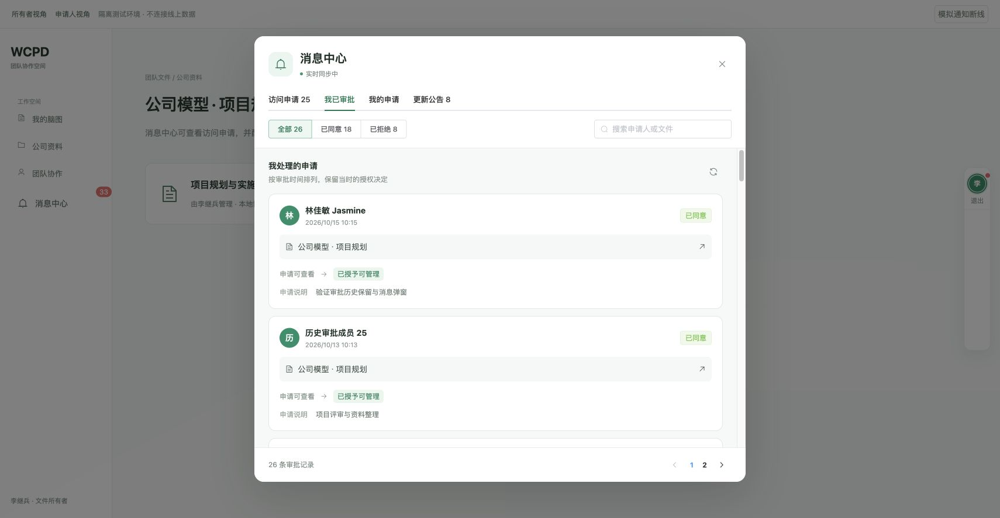
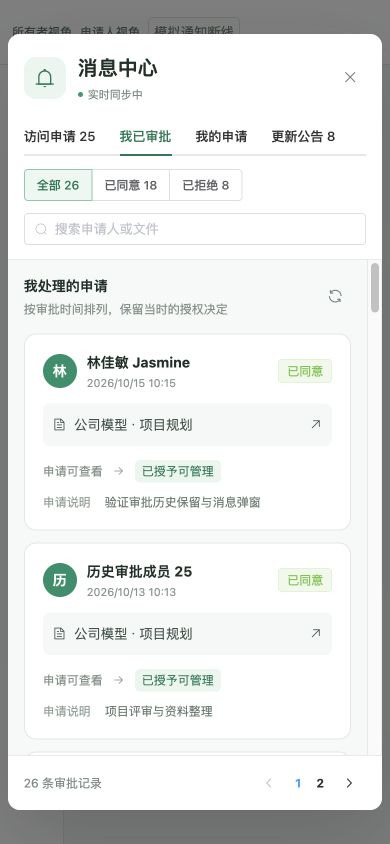
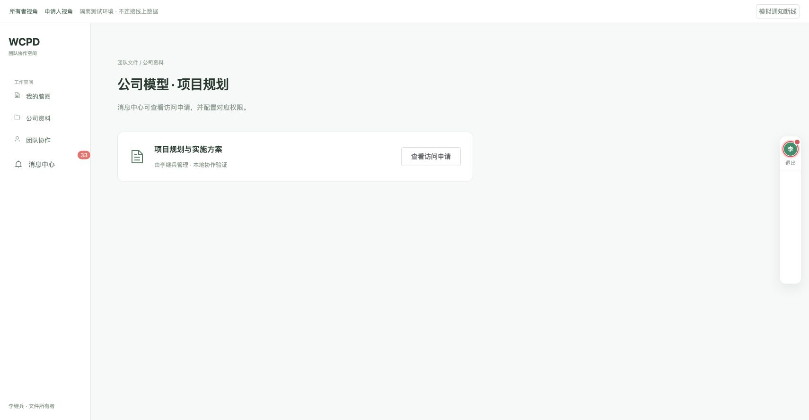

# 消息中心弹窗与个人审批历史验收

日期：2026-10-15。基于最新 `origin/main`（`365c652e`）建立 `fix/message-center-modal-history`，保留已合入的附件预览、权限管理与实时通知功能。

## 本次变化

- 脑图编辑页的消息入口集成到右侧工具栏头像。使用现有 Element UI Badge 和 UserAvatar，有待处理/未读消息时显示加大的珊瑚红圆点、同色外圈及柔和光晕；退出登录入口和工具栏原有功能保留。
- 文件主页面侧栏与脑图头像打开同一个消息弹窗，移除右下角独立悬浮按钮。头部、分类和分页固定，内容独立滚动；窄屏申请卡片改为单列。
- 分类明确区分“访问申请”“我已审批”“我的申请”“更新公告”。“我已审批”查询当前登录人亲自处理过的持久记录，显示申请人、文件、审批时间、申请说明、拒绝原因，以及当时实际授予的权限。
- 历史支持全部/已同意/已拒绝、搜索申请人或文件和每页 20 条分页。权限撤销、所有权转移、文件移入回收站不会隐藏个人审批历史；历史记录不赋予当前文件访问权限。
- 复用原审批事务、权限判断、SSE 和公告已读机制。历史按需读取，仅在打开对应分类时加载；账号退出后清理历史，过期的搜索和分页响应不会覆盖当前状态。

## 验证结果

| 检查 | 结果 |
| --- | --- |
| 脑图右侧真实 SidebarTrigger 头像入口、圆点及边框 | 通过 |
| 文件侧栏和头像打开唯一弹窗，关闭按钮/ESC，重复打开 | 通过 |
| 申请提交 → 所有者实时通知 → 自定义可管理授权 → 申请人实时可访问 | 通过 |
| 新审批进入“我已审批”，刷新页面仍保留，实际权限显示正确 | 通过 |
| 26 条个人历史：第一页 20 条，第二页 6 条 | 通过 |
| 已同意 18 / 已拒绝 8 筛选、搜索命中、分类计数 | 通过 |
| 已读申请结果与公告后，申请人的圆点和头像边框消失 | 通过 |
| 桌面与 390×844：固定工具区、独立滚动、四个标签可见、无横向溢出 | 通过 |
| PostgreSQL 个人历史身份隔离、字面搜索、分页、权限撤销、所有权转移、软删除后保留 | 通过 |
| 正式 HTTP 路由与登录 Cookie：历史可读、匿名 401、其他成员无个人审批历史 | 通过 |
| 前端历史搜索竞态、过期账号响应、加载失败保留列表及重试状态、退出清理 | 通过 |
| 原审批并发、重复重试、失败回滚、SSE、申请结果已读 | 通过 |
| 原权限弹窗、权限 ACL PostgreSQL、roomAcl、fileSystem、teamSpace 回归 | 通过 |
| 改动前端文件 ESLint 与生产构建 | 通过，保留原有构建体积提示 |
| 完整开发项目的文件列表与脑图打开、协同连接/已保存状态 | 通过，浏览器无 error 日志 |

浏览器审批验证使用生产 Vue 组件、service、请求/ACL/SSE 业务代码及专用 PostgreSQL 测试 schema。夹具只负责映射本地两个测试身份；真实协作服务的 Cookie 鉴权另由 HTTP 脚本验证。未操作线上权限、未调用企业微信扫码、未部署。原有数据库硬删除级联规则保留；本次不新增独立归档存储。

本地完整项目：`http://127.0.0.1:4320/`。审批验证页：`http://127.0.0.1:4323/owner` 和 `/applicant`。

## 复现检查

仓库根目录：

```sh
node web/scripts/verifyAccessNotificationState.cjs
node web/scripts/verifyPermissionDialog.cjs
node simple-mind-map/test/roomAcl.test.js
node simple-mind-map/test/fileSystem.test.js
node simple-mind-map/test/teamSpace.test.js
# 以下脚本必须显式指定可丢弃的测试库：
PERMISSION_TEST_DISPOSABLE=1 PGHOST=127.0.0.1 PGPORT=15439 PGDATABASE=mindmap_preview PGUSER=preview PGPASSWORD=preview-local MIND_MAP_SKIP_ROOT_ENV=1 node scripts/verifyAccessRequests.cjs
PERMISSION_TEST_DISPOSABLE=1 PGHOST=127.0.0.1 PGPORT=15439 PGDATABASE=mindmap_preview PGUSER=preview PGPASSWORD=preview-local MIND_MAP_SKIP_ROOT_ENV=1 node scripts/verifyAccessRequestHttp.cjs
PERMISSION_TEST_DISPOSABLE=1 PGHOST=127.0.0.1 PGPORT=15439 PGDATABASE=mindmap_preview PGUSER=preview PGPASSWORD=preview-local MIND_MAP_SKIP_ROOT_ENV=1 node scripts/verifyPermissionAcl.cjs
ACCESS_DEMO_MANY_REQUESTS=1 PERMISSION_TEST_DISPOSABLE=1 PGHOST=127.0.0.1 PGPORT=15439 PGDATABASE=mindmap_preview PGUSER=preview PGPASSWORD=preview-local MIND_MAP_SKIP_ROOT_ENV=1 node web/scripts/accessRequestDemo.cjs
```

前端包目录 `web/`：

```sh
./node_modules/.bin/eslint src/components/AccessNotifications.vue src/components/AccessNotificationTrigger.vue src/pages/Edit/components/SidebarTrigger.vue src/services/accessNotificationState.js src/services/accessRequestService.js
NODE_OPTIONS=--openssl-legacy-provider ./node_modules/.bin/vue-cli-service build
```






