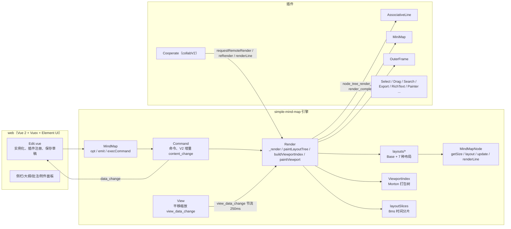
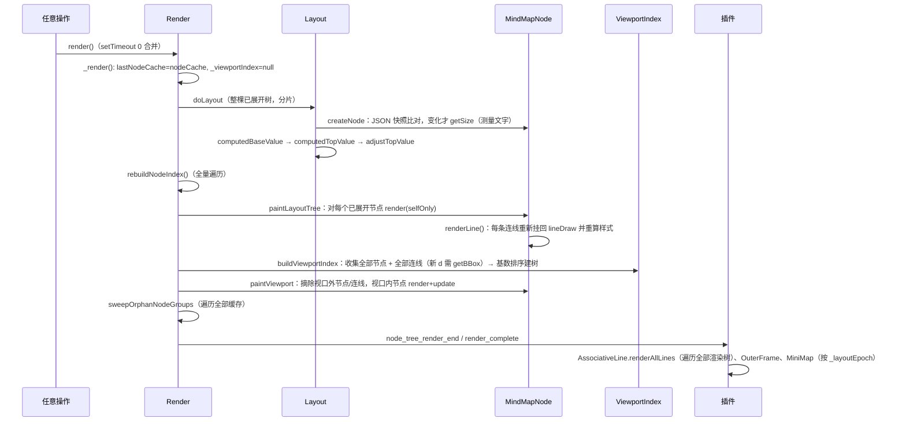
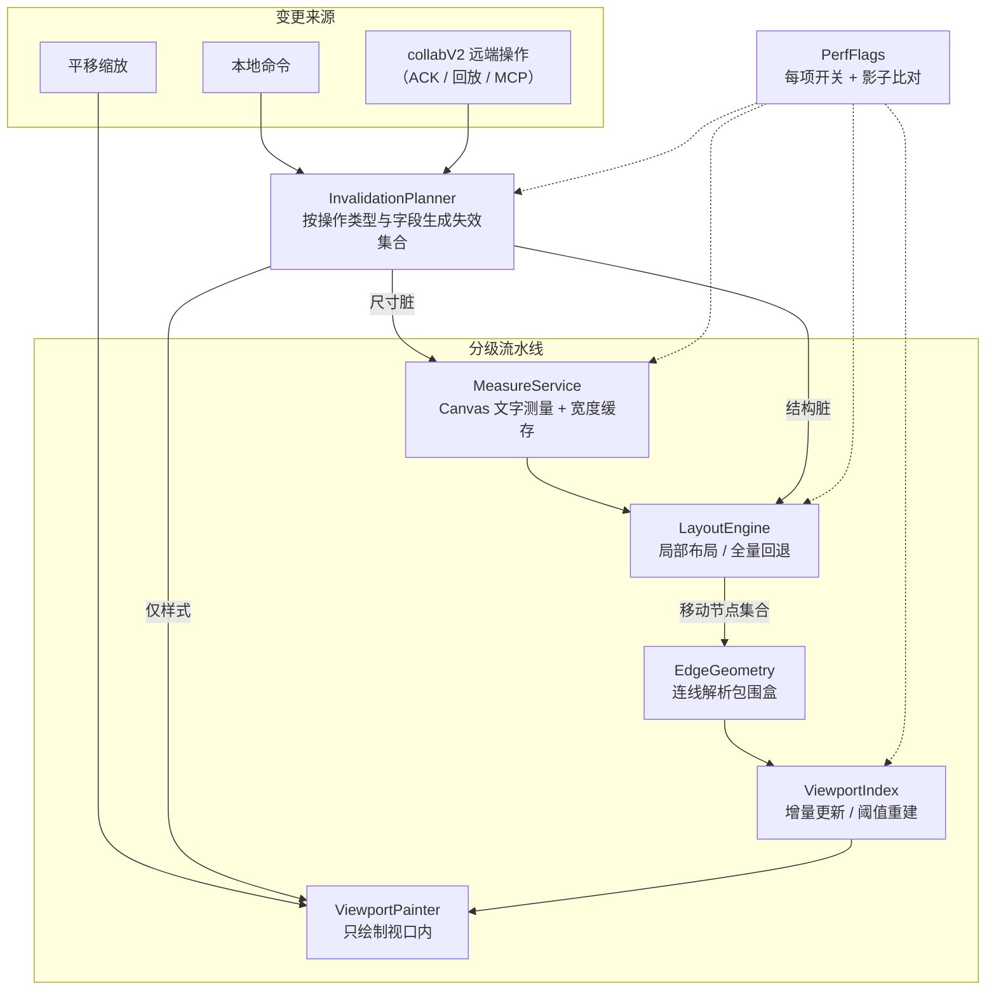

# Mind-map 渲染架构与大图性能优化方案

- 日期：2026-10-23（分析） / 2026-10-23（P1 实施） / 2026-10-23（P2 实施）
- 代码基线：`03865ed87306175372bbeafe26ac182ae147a1bf` + 本轮 P1/P2 改动（未提交）
- 测量环境：Windows 11 / Intel Core Ultra 5 125H / 24 GB / Chromium 153.0.8010.12（Playwright 无头）/ Node 22.23.1
- 测量脚本：`tests/performance/architecture-baseline.browser.cjs`（分析基线）、`tests/performance/p1-optimizations.browser.cjs`（P1 开关对照）、`tests/performance/p2-optimizations.browser.cjs`（P2 开关对照 + 个人展开不变式）
- 原始数据：`output/rendering-architecture-baseline/`、`output/p1-optimizations/p1-results.json`、`output/p1-optimizations/p1-probes-and-visual.json`、`output/p2-optimizations/p2-results.json`
- 稳定性审计（2026-10-23，不进 P3）：`docs/p1-p2-stability-audit.md`；复测数据 `output/p2b-first-render-repeat/`、`output/p1p2-compat-isolated/`

证据等级标注（全文统一）：

| 标注 | 含义 |
| --- | --- |
| 【源码】 | 读源码确认的事实，附文件与行号 |
| 【实测】 | 本轮脚本测得，附场景与数值 |
| 【历史】 | 来自仓库已有报告，已注明日期并复核是否过期 |
| 【推断】 | 由源码与数据推出，尚未单独实测 |
| 【未验证】 | 需要服务器、真实房间或多端环境，本轮无法测量 |

---

## 0. 结论摘要

1. **“展开越多越慢”的主因不是 SVG 节点太多，而是每次操作都在整棵已展开树上跑一遍完整流水线。** 视口裁剪已经生效，10000 节点时整页只有约 1300 个 DOM 元素【实测】；但任何一次改字、插入、删除、展开、远端更新，都会触发：整树布局 → 对每个已展开节点调用 `node.render()`（含连线重挂）→ 全量重建视口空间索引 → 视口绘制【源码】。这条流水线的 CPU 时间与“已展开节点数”线性相关：150 / 1000 / 3000 / 6000 / 10000 节点时一次无数据变化的重绘分别约 8 / 57 / 215 / 301 / 656 ms【实测】。
2. **新出现的节点要付一次昂贵的文字测量费。** 普通文本节点测量尺寸时逐字符创建 SVG `<text>` 并调用 `getBBox`，平均每个节点约 56 次【实测】；首次渲染 CPU 剖析中 SVG 测量链路占约 60%【实测】。富文本的简单段落路径早已改用 Canvas 测量，每节点只需 1 次 `getBBox`，3000 节点首屏 1.1 秒，对比普通文本 18–45 秒【实测】。
3. **SVG 引擎值得继续优化，暂不需要 Canvas/WebGL 重写。** 平移帧在 10000 节点时 P50/P95 仍为 17/18 ms【实测】，瓶颈在 CPU 侧的整树计算，换渲染后端解决不了。收益最大的四处：文字测量改 Canvas、远端更新按需重算、视口外节点与连线不做 DOM 工作、局部布局。
4. **Canvas 只在“极度缩小看全局”时才可能需要。** 缩放到 0.15 时一次视口绘制要 160–450 ms、挂载约 220 个节点组【实测】；若完成 P1–P3 后此场景仍超过阈值（见第 9 节），再引入“语义缩放 + Canvas 概览层”，WebGL 不建议。
5. **局部布局可以做到正确**：先在逻辑结构布局上实现“子树重排 + 祖先链回溯 + 兄弟子树平移”，用“影子全量布局比对”在灰度期逐次校验坐标，其余布局继续走全量。协同正确性不受影响，因为布局只读取已应用的模型状态，不改修订号、不改协议、不改持久化字段。

P1 已落地（默认关闭，见下一节）：远端样式连线重挂、普通文本 Canvas 测量、远端尺寸未变跳过整树、草稿复制前先看节流。P2-A/B 已落地（默认关闭）：解析连线包围盒、视口外跳过 SVG 绘制。P2-C 不做，依赖 P3 脏集。P3 未开始。个人展开/布局偏好的持久化语义未改。

---

## P1 实施结果（2026-10-23）

本轮只做低风险 P0/P1，没有局部布局、Canvas 全图或 WebGL。四个 P1 开关默认全部关闭，打开方式：构造参数 `performanceFlags`，或编辑页 URL `?perfFlags=scopedRemoteLineRender,canvasTextMeasure,scopedRemoteGeometry,deferDraftCopy`。P2 另加 `analyticEdgeBounds,lazyOffscreenPaint`。

| 开关 | 默认 | 解决的问题 |
| --- | --- | --- |
| `scopedRemoteLineRender` | 关 | 远端普通样式不再 `parent.renderLine(true)` 递归重挂整树连线；可继承连线样式仍从变更节点向下传播 |
| `canvasTextMeasure` | 关 | 普通文本换行改 Canvas 整串测量（保留 kerning）；字距/字体未就绪/双向覆盖符回退 SVG |
| `scopedRemoteGeometry` | 关 | 看 `reRender()` 的尺寸变化；没变就不 `scheduleRemoteGeometryRender` |
| `deferDraftCopy` | 关 | 协作草稿若仍在 3 秒节流窗口内，先推迟，不先 `getCopyData()`；`force` 保存不受影响 |

### 已经真正解决的问题

**1. 远端样式更新把几千条连线挂回 DOM**

6000 节点、对二级节点只改 `fillColor`，走真实的 `Cooperate.applyHttpRemoteNodeFields`：

| 开关 | 同步耗时 | 改前挂载 path | 改后挂载 path |
| --- | --- | --- | --- |
| 关 | 33.4 ms | 23 | **6005** |
| 开 | 2.0 ms | 23 | **23** |

可继承连线颜色：对二级节点写 `lineColor: #cc2244` 后，子节点 `getSelfInhertStyle('lineColor')` 仍为 `#cc2244`，两条出线 stroke 也是该颜色（开关开/关一致）。

**2. 普通文本测量的 SVG `getBBox` 爆炸**

换行改为对整行字符串做 Canvas `measureText`，不是把单字宽度加起来。字距非 0、字体 `document.fonts.check` 失败、双向覆盖符走原来的 SVG 测量。最终节点尺寸仍用一次 `g.bbox()`，用来对齐导出。

7 个样本文本（短中文、中英、长中文换行、emoji 混排、AV 字距、粗体混排）：开关开/关节点坐标差 ≤ 1px，`getSvgData()` HTML **完全一致**（10241 字节）。

首次渲染（墙钟 / `getBBox` 次数）：

| 节点数 | 开关关 | 开关开 | 首屏加速 | getBBox 下降 |
| --- | --- | --- | --- | --- |
| 150 | 1411 ms / 9068 | 393 ms / 1676 | 3.6× | 5.4× |
| 1000 | 4274 ms / 58991 | 930 ms / 7455 | 4.6× | 7.9× |
| 3000 | 13161 ms / 184489 | 3786 ms / 21037 | 3.5× | 8.8× |
| 6000 | 22914 ms / 373438 | 3711 ms / 42094 | 6.2× | 8.9× |
| 10000 | 34963 ms / 625221 | 6671 ms / 70113 | 5.2× | 8.9× |

说明：150 节点仍走默认紧凑布局（可见节点 < 250），1000 及以上会降级为逻辑结构，所以 150 的 `initLayouts` 计数器没打到 `LogicalStructure.doLayout`。这不影响首屏与 bbox 对比。

**3. 远端字段更新不再“凡是几何字段就整树排”**

1000 节点，空批注（尺寸不变）vs 明显更长的文本：

| 开关 | 尺寸未变时安排整树 | 尺寸变了时安排整树 |
| --- | --- | --- |
| 关 | 1 | 1 |
| 开 | **0** | 1 |

协同协议、ACK、revision、gap/resync、懒加载、个人 `expand` 字段均未改。远端 payload 仍删除 `expand`。

**4. 草稿保存可以先看节流再复制整树**

`shouldDeferDraftTreeCopy` 单测覆盖：未到期且有待存树 → 推迟并保留 pending；`force`、关开关、无待存树、窗口已到 → 立即复制。`flushStoreData(true)` / 手动保存仍强制 `getCopyData()`。没有做整树复制的浏览器计时（需要完整 Edit 页 + IndexedDB），逻辑已接上。

### 单次更新：这些开关帮不上忙

P1 不改整树流水线。无数据变化的 `mm.render()`（墙钟，每次 1 次整树布局）：

| 节点数 | 开关关 | 开关开 |
| --- | --- | --- |
| 150 | 13.7 ms | 10.7 ms |
| 1000 | 41.6 ms | 56.2 ms |
| 3000 | 135.9 ms | 183.6 ms |
| 6000 | 140.3 ms | 184.5 ms |
| 10000 | 252.1 ms | 236.4 ms |

本地 `SET_NODE_TEXT` 墙钟同样在同一量级（10000 节点 237 / 220 ms），且 `editLayouts` 仍为 1。开关开时改字的 `getBBox` 从 46 降到 6，但被整树重绘淹没。空载重绘的开/关差异是机器波动，**不是回归**（DOM 数量完全一致）。

分析阶段 10000 节点空载约 656 ms CPU / 739 ms 墙钟，本轮空载约 250 ms，树更简单（无附件/批注/长分支），不能和那次基线直接比绝对值。

### 视觉、导出、DOM

- 样本文本几何：0 处超过 1px 的差异；导出 SVG HTML 相等。
- 规模树在开关开/关下挂载的 SVG 元素、节点组、path 数量相同（例如 10000 节点：92 / 6 / 46）。
- 未跑 PNG/PDF/XMind 真机导出，也未跑移动端。【未验证】

### 失败测试与剩余风险

- `simple-mind-map/test/p1PerfPlan.test.js`、`web/tests/draftFlushPlan.test.cjs`、P1 浏览器脚本全部通过。
- `simple-mind-map/test/collabNodeFeatures.test.js` 在未改该文件的情况下因 `PRECONDITION_REQUIRED`（受保护节点缺少 expected）失败，与本轮改动无关，未当作 P1 回归。
- 未验证：真实多人 ACK、MCP 写入、断线追赶、自定义未加载字体在用户机器上的换行、字距非 0 的节点（走 SVG 回退）。
- 风险：Canvas 与 SVG 在极端字体上仍可能有亚像素差，目前样本未出现；`deferDraftCopy` 若关开关，行为与改前完全相同。

### 下一轮优先做什么

**先做视口外 DOM 工作（原 P2），不要先做局部布局（原 P3）。**

理由：P1 已经削掉首屏测量和远端样式误伤。剩下的每次操作成本仍是“对全部已展开节点 `render` + 重挂连线 + 重建索引”。分析阶段 10000 节点空载里，节点树绘制约 283 ms、索引约 121 ms、布局约 180 ms。P2 去掉视口外 DOM 工作，切的是最大且风险更低的一块；P3 局部布局正确性成本高，而且要先有增量索引才稳。

---

## 个人视图状态审计（P2 前置，只读）

个人展开与个人布局不是协同树字段，也不是 DOM 挂载状态。【源码】

| 机制 | 位置 | 作用 |
| --- | --- | --- |
| 存储键 | `web/src/utils/personalExpandState.js` | `mind-map-personal-expand:v1:${userId}:${roomKey}`，用户+房间隔离 |
| 收集/应用 | 同上 `collect/applyPersonalExpandState` | 只走 `renderTree.data.expand`，不看 `group` 是否挂载 |
| 保护 uid | `collectExpandProtectUids` | 激活/编辑中的节点及其祖先：恢复时不得被收起 |
| 恢复门闩 | `web/src/utils/expandRestoreGate.js` | 同一棵树、同一修订、同一偏好不重复恢复 |
| 绑定/恢复 | `CooperateDialog.vue` `bind/restore/unbindPersonalExpandState` | 命令即时写入；`node_tree_render_end` 再对齐；离开房间先保存再清空 |
| 服务端副本 | `fileApi.get/savePersonalViewState` | `/api/files/:room/view-state`，350ms 防抖 |
| 个人外观 | `web/src/utils/personalAppearance.js` | 主题/自定义主题/布局，同样按用户+房间 |
| 命令分类 | `personalViewCommands.js` + `Command.js` | `SET_NODE_EXPAND` / 批量展开收起不进 V2 历史、不进协同内容 |
| 远端剥离 | `Cooperate.applyHttpRemoteNodeFields` | 入站字段删除 `expand` |
| 懒加载配合 | `restorePersonalExpandState` | 最多 20 轮：apply → render → `hydrateExpandedPartialParents({render:false})` |
| 大图概览 | `applyPreview` + `stubImportedTree` | 先收深层以便首屏，揭开后必须 `restorePersonalExpandState` |

视口卸载本来就是 DOM-only：`paintViewport` 的 `group.remove()` 不写 `data.expand`。`findNodeByUid` 走 `nodeIndex`（布局实例），不走已挂载组。P2 必须保持这一点：缺 DOM ≠ 节点不存在 ≠ 折叠。

### 八项验证（本轮能证明的部分）

| # | 场景 | 结果 | 证据等级 |
| --- | --- | --- | --- |
| 1 | 用户 A 展开后退出再进 | 绑定读 localStorage + 服务端，恢复循环未改 | 存储键【源码】；真房间进出【未验证】 |
| 2 | 用户 A 折叠后刷新 | 折叠写入 `data.expand` 并 persist；刷新后走同一恢复 | 浏览器：折叠后仍 `expand===false`【实测】；真 F5【未验证】 |
| 3 | 用户 B 不影响 A | 键含 `userId` | 单测隔离【实测】；双端真人【未验证】 |
| 4 | 远端增删改不重置展开 | `applyHttpRemoteNodeFields` 删 `expand` | 浏览器：远端带 `expand:false` 后本地仍展开【实测】 |
| 5 | 视口外卸载再挂载 | 平移后 group 卸掉，`expand` 不变；移回仍折叠 | 浏览器 off/P1/P1+A/B 一致【实测】 |
| 6 | 懒加载水合不覆盖已恢复展开 | 水合读实例上的 `expand`；P2 不写该字段 | 恢复循环【源码】；真实 `httpFetchSubtree`【未验证】 |
| 7 | 切房间再回来 | `unbind` 先保存再清空，再 `bind` 新房间键 | 键隔离【实测】；完整路由切换【未验证】 |
| 8 | 优化开关开/关 | 同一棵 80 节点树，折叠/平移/远端后的 expand 图完全一致 | 浏览器 off / P1 / P1+A+B【实测】 |

P2 **没有修改** `personalExpandState.js`、`personalAppearance.js`、`expandRestoreGate.js`、`fileApi` 的 view-state、`CooperateDialog` 绑定/恢复、以及远端剥离 `expand` 的逻辑。

### 既有问题（单独列出，不进 P2）

1. **大图概览会先改树上的 `expand`。** `stubImportedTree(..., keepDepth: 1)` 为了首屏把深层收起，之后再恢复个人偏好。恢复失败或水合中断时，用户会看到比个人偏好更收的树。
2. **远端新插入的子节点本地写成 `expand: false`。** 新 uid 从折叠开始，不改父节点展开。这是既有插入策略。
3. **定位/概要水合会强制 `expand: true`。** `expandTreeNode`、`hydrateGeneralizationParent` 为了拉路径/概要，可能展开用户已折叠的祖先。
4. **服务端 view-state 在本地未脏时覆盖 localStorage。** `{...local, ...remote}`，同用户多标签页后写覆盖。
5. **`collectPersonalExpandState` 会把当前树上所有 uid 记进快照。** 含远端新插入的折叠节点；下次恢复会维持这些新节点折叠。
6. **个人外观在每次 `node_tree_render_end` 尝试 restore。** 可能把主题/布局拉回已存偏好。

以上都不在本轮性能改动里修。

---

## P2 实施结果（2026-10-23）

只动 SVG 绘制与视口索引，不动协议、修订、ACK、个人视图持久化。两个新开关默认关闭，P1 四个开关保持原样。打开方式与 P1 相同：`performanceFlags` 或 `?perfFlags=`。

| 开关 | 默认 | 解决的问题 |
| --- | --- | --- |
| `analyticEdgeBounds` | 关 | `buildViewportIndex` 用路径 `d` 解析包围盒，不再对每条连线 `getBBox`；解析失败仍回退 `getBBox` |
| `lazyOffscreenPaint` | 关 | 布局 DFS 对视口外节点跳过 `node.render()`（不建组、不画线）；索引用解析/干跑几何；进入视口再挂载。干跑会还原 `node._lines`，避免组织结构图把 stub 推进真连线 |

P2-C（增量空间索引）**不做**。【推断】全量 `doLayout` 仍会改所有已展开节点坐标；没有 P3 脏集时，增量索引仍要扫整棵树更新盒子，省下的只是 Morton 重建，收益小、正确性成本高。P2-A 已经去掉索引里最贵的 `getBBox`。

### 个人展开不变式【实测】

80 节点、`openPerformance`，开关 `off` / `p1` / `p1ab` 三组结果相同：

- 折叠二级节点后 `expand === false`，子节点自身 expand 仍为 true（只是不在布局实例里）
- 平移出视口后 group 卸掉，`expand` 图不变；移回后仍折叠
- `applyHttpRemoteNodeFields({ expand: false, fillColor })` 不改变本地 expand
- `findNodeByUid` 在卸载后仍能找到该节点

### 开关对照【实测】

墙钟有机器波动，先看 `getBBox` 次数和挂载组数。6000+ 未跑全关（P1 已证明测量爆炸，本轮以 P1 为对照基线）。

**150**

| 开关 | 首屏 | getBBox | 空载 | 改字 | 挂载组 / path |
| --- | --- | --- | --- | --- | --- |
| 全关 | 1396 ms | 9068 | 25 ms | 42 ms | 33 / 74 |
| P1 | 767 ms | 1676 | 31 ms | 24 ms | 33 / 74 |
| P1+A | 543 ms | 1527 | 19 ms | 22 ms | 33 / 74 |
| P1+A/B | 528 ms | 1527 | 21 ms | 24 ms | 33 / 74 |

**1000**

| 开关 | 首屏 | getBBox | 空载 | 改字 | 挂载组 / path |
| --- | --- | --- | --- | --- | --- |
| 全关 | 5632 ms | 58991 | 113 ms | 99 ms | 24 / 67 |
| P1 | 1412 ms | 7455 | 60 ms | 57 ms | 24 / 67 |
| P1+A | 1294 ms | 6456 | 44 ms | 45 ms | 24 / 67 |
| P1+A/B | 1210 ms | 6456 | 38 ms | 39 ms | 24 / 72 |

**3000**

| 开关 | 首屏 | getBBox | 空载 | 改字 | 挂载组 / path |
| --- | --- | --- | --- | --- | --- |
| 全关 | 17700 ms | 184489 | 154 ms | 132 ms | 2 / 27 |
| P1 | 2247 ms | 21037 | 106 ms | 71 ms | 2 / 27 |
| P1+A | 3231 ms | 18038 | 262 ms | 188 ms | 2 / 27 |
| P1+A/B | 2388 ms | 18038 | 85 ms | 57 ms | 2 / 27 |

**6000**

| 开关 | 首屏 | getBBox | 空载 | 改字 | 挂载组 / path |
| --- | --- | --- | --- | --- | --- |
| P1 | 4633 ms | 42094 | 306 ms | 211 ms | 5 / 23 |
| P1+A | 5488 ms | 36095 | 397 ms | 314 ms | 5 / 23 |
| P1+A/B | 7199 ms | 36095 | 202 ms | 194 ms | 5 / 35 |

**10000**

| 开关 | 首屏 | getBBox | 空载 | 改字 | 挂载组 / path |
| --- | --- | --- | --- | --- | --- |
| P1 | 11316 ms | 70113 | 442 ms | 496 ms | 6 / 46 |
| P1+A | 10146 ms | 60114 | 524 ms | 554 ms | 6 / 46 |
| P1+A/B | 8149 ms | 60114 | **190 ms** | **177 ms** | 6 / 46 |

解读：

- P2-A 稳定少约 `节点数` 量级的连线 `getBBox`（1000: −999，3000: −2999，6000: −5999，10000: −9999）。
- P2-B 在大图上切开空载/改字：10000 节点空载 442→190 ms，改字 496→177 ms。仍会做一次全量布局，所以不是数量级下降。
- **挂载组数开/关一致**，展开结构没变。1000/6000 的 P2-B 多了几条 path，是解析盒把原先 `getBBox` 塌到原点的连线放回真实位置后进入视口，不是展开被改写。
- P1+A 单独空载有时更慢，属机器波动；以次数和 P1+A/B 组合为准。

原始 JSON：`output/p2-optimizations/p2-results.json`。

### 几何与回退

- `edgeGeometry` 单测覆盖直线、二次/三次凸起、折线、相对命令、stroke/marker 膨胀、干跑不污染 `_lines`。
- 浏览器 40 条真连线均可解析（missing=0）。最坏差 953px 来自一条已画出的折线：`getBBox` 塌成原点附近 `(-2,-2,2,2)`，解析盒是路径真实坐标 `(915,-238)–(955,-105)`。说明部分连线的 `getBBox` 并不可靠，解析盒更接近模型空间；索引宁可偏大不可偏小。
- 小地图：没有 `_lines` 时改画已存 `d`，不要求主画布挂载。
- 导出仍走 `forceLoadNode` 全量绘制。

### 未改的文件（个人视图）

`web/src/utils/personalExpandState.js`、`personalAppearance.js`、`expandRestoreGate.js`、`fileApi` 的 view-state API、`CooperateDialog` 的 bind/restore、`applyHttpRemoteNodeFields` 删除 `expand`。

稳定性 / 6000 首屏交错复测 / 兼容性 / 个人视图入口与灰度结论见 `docs/p1-p2-stability-audit.md`。本轮不进入 P3。

---

## 1. 历史报告复核

| 报告 | 日期 | 关键结论 | 当前是否仍成立 |
| --- | --- | --- | --- |
| `docs/collab-performance-diagnosis.md` | 2026-10-12 | MCP 写入走整图事务；`applyV2PayloadInsert` 会把父节点强制展开并整树重绘 | 前半部分属于服务端，本轮未复测【未验证】；**后半部分已过期**：当前代码对折叠父节点只做 `childCount+1`、标记脏、`parentNode.reRender()`，不再强制展开（`Cooperate.js:3910` 起）【源码】 |
| `docs/performance-diagnostics.md` | 2026-10-13 前后 | 有 `/api/diagnostics/performance` 与 `&perfDiagnostics=1` 浏览器采样；V2 `format=meta` 轻量读；MCP 直写路径有开关 | 仍成立【源码】，可作为线上验收数据源 |
| `docs/performance-recheck-20261014-0936.md` | 2026-10-14 | 生产样本：单会话最多渲染 3623 节点，render 最长 2647 ms，长任务最长 2382 ms；另一会话 162 节点 render 79948 ms 但长任务最长 161 ms | 第一组与本轮趋势一致；**第二组是测量配对错误**：`node_tree_render_start` 与 `render_complete` 配对，而视图路径只发 start/end 不发 complete，导致跨越多次操作的“假长渲染”。改进项见 P1-6 |
| `docs/performance-wb-review-20261014.md` | 2026-10-14 | 子树分页/懒加载修复后，生产渲染 87 个样本 P95 228 ms、最长 1909 ms；ACK 最长 147 ms | 生产数据本轮无法复测【未验证】，量级与本轮 3000–6000 节点实测一致 |
| `docs/performance-repair-20261013.md` | 2026-10-13 | 事件桥去重、子树计数缓存、水合生命周期；6000 节点夹具首屏 8 个节点 | 仍成立；说明线上首屏依赖懒加载，**变慢发生在用户逐步展开之后**，与用户描述一致 |
| `docs/plans/2026-10-13-mind-map-performance-plan.md` | 2026-10-13 | T00–T14 计划 | 已落地：小地图轮廓缓存、`nodeIndex` Map、增量 `content_change`、V2 历史、打包空间索引、兄弟子树两遍平移。**未落地**：真正的局部布局（T13b 只做了线性化）、远端脏集合消费 |

结论：历史报告中“首屏慢”的问题已靠懒加载缓解；**“展开后越来越慢”这一现象在历史报告中没有被拆到函数级**，本报告补齐。

---

## 2. 当前架构与调用链

### 2.1 模块总览



### 2.2 一次整树重绘（性能模式）的调用链



源码位置：`Render.js` `render` 773、`_render` 822、`paintLayoutTree` 933、`buildViewportIndex` 956、`paintViewport` 1069、`rebuildNodeIndex` 3656；`MindMapNode.js` `getSize` 347、`update` 569、`render` 746、`renderLine` 972；`Base.js` `createNode` 116、`checkIsNodeDataChange` 76。

### 2.3 各类操作进入哪条路径

| 操作 | 入口 | 是否整树布局 | 备注 |
| --- | --- | --- | --- |
| 平移/缩放 | `View.transform` → `view_data_change` → 节流 250 ms → `paintViewport()` | 否 | 只查索引并补挂/摘除，**这是唯一真正增量的路径** |
| 本地改字（尺寸不变） | `setNodeDataRender` → `reRenderNodeCheckChange`（`Render.js:3501`） | 否 | 直接 `node_tree_render_end` |
| 本地改字（逻辑结构、叶子、高度不变） | 同上，快速路径 3512–3529 | 否 | 更新索引中这一个节点 + `paintViewport(new Set([node]))` |
| 本地改字（其他情况） | 同上 → `mindMap.render()` | **是** | |
| 插入/删除/移动 | 命令 → `render()` | **是** | |
| 展开/收起 | `setNodeExpand`（`Render.js:2726`）→ 改 `expand` → `render()` | **是** | 新节点首次 `getSize` |
| 远端更新几何字段 | `applyHttpRemoteNodeFields`（`Cooperate.js:6007`）→ `reRender` + `parent.renderLine(true)` + `scheduleRemoteGeometryRender` | **是**，且不看尺寸是否变化 | 调度器收集的 `dirtyUids` 在 `onFlush` 中被忽略 |
| 远端更新样式字段 | 同上，但不安排布局 | 否 | `renderLine(true)` 会深度重挂连线（见 B3） |
| 远端插入（父节点已展开） | `applyV2PayloadInsert` → `requestRemoteApplyRender` | **是** | 新子节点 `expand:false` |
| 远端插入（父节点折叠/未加载） | `deferUnloadedRemote` / `childCount+1` | 否 | 不改个人展开状态 |
| 远端连发 | `remoteRenderScheduler`（rAF + 最长 50 ms） + `isRendering` 排队 | 合并后仍为整树 | 3000 节点以上 40 次更新合并为 6–11 次整树重绘【实测】 |

---

## 3. 能力盘点

| 能力 | 状态 | 依据 |
| --- | --- | --- |
| 视口裁剪（`openPerformance` + `removeNodeWhenOutCanvas`） | **有效** | 10000 节点整页约 1344 个元素，挂载节点组 29 个【实测】 |
| 打包空间索引 `ViewportIndex` | **有效但每次重建** | `_render` 中 `_viewportIndex = null`；10000 节点重建 120 ms【实测】；`update(item)` 只在本地快速路径用到 |
| 时间分片 `walkLayoutInSlices` / `runWorkInSlices` | **有效** | 常规操作长任务为 0【实测】；但每次迭代都调用 `performance.now()`，剖析中约占 7%【实测，受剖析器放大】 |
| 渲染代际取消 `_renderGeneration` | **有效** | 被新渲染接管时让出 |
| 节点 LRU 缓存（`maxNodeCacheCount` 1000） | **有效** | 5 次创建/销毁 3000 节点后堆稳定在 3.2–3.4 MB，无泄漏【实测】 |
| 尺寸脏检查 | **受限** | 每节点每次渲染做 `JSON.stringify` 快照 + 结构快照（`Base.js:147,222,331`）；6000 节点空载重绘 18007 次【实测】 |
| 本地改字快速路径 | **受限** | 仅逻辑结构、叶子、无概要、高度不变时生效（`Render.js:3512`） |
| 远端渲染调度合并 | **受限** | 合并有效，但 `dirtyUids` 未被消费，合并后仍整树 |
| 紧凑布局预算（>250 可见节点降级为逻辑结构） | **有效** | `COMPACT_VISIBLE_NODE_LIMIT` |
| 个人展开状态不入历史、不持久化 | **有效** | `Command.js` 个人视图命令；远端 payload 删除 `expand` 字段 |
| V2 增量历史 | **有效** | `recordContentChange/flushContentChange` |
| 小地图轮廓缓存 | **有效** | 以 `_layoutEpoch` 为键；但重建时克隆全部连线（P2 依赖项） |
| 兄弟子树线性平移 `adjustSiblingSubtrees` | **有效** | 两遍累计位移（`Base.js:605`） |
| 富文本简单段落 Canvas 测量 | **有效** | `wrapPlainLines`（`nodeCreateContents.js:62`），每节点 1 次 `getBBox`【实测】 |
| 普通文本 Canvas 测量 | **缺失** | `createTextNode` 仍用 SVG 逐字符测量（`nodeCreateContents.js:30,492`） |
| 局部布局 | **缺失** | 任何结构/尺寸变化都整树布局 |
| 连线解析式包围盒 | **缺失** | 依赖 DOM `getBBox`，因此需要把视口外连线也画出来 |
| 语义缩放（缩小时简化绘制） | **缺失** | 缩放到 0.15 仍按完整节点绘制 |
| Worker 布局 | **不建议（现阶段）** | 布局与 `getSize`/DOM 测量耦合；纯数学部分 10000 节点仅约 180 ms，传输与同步成本不划算 |
| WebGL 渲染 | **不建议** | 瓶颈在 CPU；PixiJS 文档明确“CPU 受限时裁剪反而降低性能” |
| 格式刷 `Painter` 带来的 `effectiveStyles` 展开开销 | **未证实** | 带/不带 Painter 两组各两次，空载重绘 170–280 ms，差异落在噪声内【实测】 |
| 关联线 `renderAllLines` 全量重建 | **未验证** | 合成数据没有关联线；源码上每次 `node_tree_render_end` 与 `data_change` 都会遍历（`AssociativeLine.js:89,91,211`） |
| 协同 ACK 延迟、MCP 写入、断线追赶 | **未验证** | 需要服务器与开发密钥，本轮按约束未连接 |

---

## 4. 性能基线（本轮实测）

### 4.1 测量方法

- 数据：`makeTree(n)` 广度优先生成，根节点 12 个子节点、其余 8 个；每 7 个节点一条长中文；按比例带备注、超链接、标签、图标、附件、批注；根下第一个分支挂两个**折叠**的测试分支 `exp60`（60 个子节点）与 `exp400`（400 个子节点）。全部节点处于展开状态（除测试分支），模拟“用户已展开大量节点”。
- 插件：MiniMap、Drag、KeyboardNavigation、Export、Select、AssociativeLine、Search、RainbowLines、OuterFrame；富文本与 Painter 分组单独测。
- 计时：
  - **CPU**：`render_started` 到 `render_complete` 期间各阶段函数的同步执行时间之和（布局 / 节点树绘制 / 索引 / 视口绘制），不含分片让出的等待。
  - **墙钟**：从发起操作到 `render_complete`，包含 `setTimeout 0`、分片让出、排队等待。
  - 长任务：`PerformanceObserver('longtask')`。
- 每场景采样 2–5 次，报告 P50/P95/最大值。**本机计时波动大**：同一棵 3000 节点树首次渲染在 6 次独立运行中分别为 33.5 / 18.4 / 45.1 / 37.6 / 37.3 / 32.2 秒。因此绝对值仅供量级参考，**判断以计数器和阶段占比为主**。

### 4.2 规模与操作（CPU P50 ms，括号内为墙钟 P50 ms）

| 场景 | 150 | 1000 | 3000 | 6000 | 10000 |
| --- | --- | --- | --- | --- | --- |
| 首次渲染（墙钟） | 767 | 4 125 | 18 434–45 117 | 42 723 | 95 765 |
| 首次渲染长任务（次数/最长） | 0 / 0 | 0 / 0 | 47 / 853 | 3 / 156 | 33 / 575 |
| 首次渲染 `getBBox` 次数 | 8 154 | 53 402 | 167 263 | 339 020 | 568 078 |
| 无数据变化重绘 | 7.9 (94) | 56.7 (139) | 215 (296) | 301 (384) | 656 (739) |
| 改字（尺寸变化） | 6.2 (101) | 27.5 (137) | 151 (265) | 213 (330) | 591 (736) |
| 改非尺寸字段 + render | 13.1 (109) | 58.7 (153) | 173 (278) | 172 (272) | 653 (774) |
| 插入子节点 | 21.2 (110) | 70.9 (168) | 165 (265) | 273 (371) | 694 (822) |
| 删除节点 | 28.0 (123) | 51.9 (140) | 161 (247) | 258 (348) | 797 (888) |
| 展开再收起 60 子节点（2 次整树） | 30.5 (248) | 34.6 (262) | 330 (1 703) | 320 (772) | 863 (2 147) |
| 展开 400 子节点（墙钟） | 4 657 | 1 462 | 2 706 | 3 236 | 2 706 |
| 其中布局阶段 | 2 050 | 1 305 | 2 325 | 2 730 | 2 059 |
| 收起 400 子节点（墙钟） | 736 | 187 | 491 | 920 | 773 |

说明：

- 部分规模下“改字”比“空载重绘”还便宜，差异来源本轮未单独拆分；两者走同一条整树流水线，量级一致。
- “展开 400”的布局阶段主要是 400 个新节点的首次 `getSize`（文字测量），约 5–7 ms/节点，与首次渲染的单节点成本一致。
- 墙钟与 CPU 的差值是分片让出与 `setTimeout` 等待，不阻塞主线程，但**用户仍要等这么久才能看到结果**。

### 4.3 无数据变化重绘的阶段拆分（CPU P50 ms）

| 节点数 | 整树布局 | 节点树绘制（render + renderLine） | 视口索引重建 | 视口绘制 | 其他 |
| --- | --- | --- | --- | --- | --- |
| 150 | 3.9 | 2.1 | 0.9 | 0.8 | 0.2 |
| 1000 | 14.4 | 24.9 | 9.5 | 4.0 | 3.9 |
| 3000 | 65.4 | 73.6 | 42.8 | 14.1 | 19.3 |
| 6000 | 92.2 | 114.3 | 57.4 | 17.7 | 19.2 |
| 10000 | 178.5 | 283.2 | 120.5 | 50.4 | 23.6 |

**节点树绘制是最大单项**，而它对视口外节点做的事情（重挂连线、重算样式，然后被视口绘制摘掉）对最终画面没有贡献。

### 4.4 平移与缩放

| 节点数 | 平移帧 P50/P95/最大（ms） | 平移时单次视口绘制 P95 | 缩小到 0.15：帧 P95/最大 | 缩小时视口绘制 P50/P95 | 0.15 时挂载节点组 |
| --- | --- | --- | --- | --- | --- |
| 150 | 16.6 / 18.1 / 18.7 | 13 | 18.6 / 27 | 66 / 118 | 133 |
| 1000 | 16.6 / 18.0 / 19.8 | 10 | 49.3 / 205 | 57 / 287 | 215 |
| 3000 | 16.7 / 18.7 / 23.5 | 98 | 105 / 321 | 292 / 403 | 214 |
| 6000 | 16.6 / 18.1 / 23.6 | 105 | 21.2 / 23.1 | 161 / 453 | 213 |
| 10000 | 17.0 / 18.0 / 18.1 | 13 | 21.1 / 25 | 199 / 348 | 221 |

平移在所有规模下都流畅；缩小看全局时，每次视口绘制要为约 220 个节点创建完整节点组，这是 Canvas 概览层唯一可能值得引入的场景。

### 4.5 不同布局（3000 节点）

| 布局 | 首次渲染（ms） | 空载重绘 CPU P50 | 其中布局 |
| --- | --- | --- | --- |
| 逻辑结构 | 18 434 | 107 | 27 |
| 思维导图 | 22 246 | 198 | 48 |
| 组织结构 | 22 140 | 233 | 76 |
| 目录组织 | 23 941 | 251 | 84 |
| 时间轴 | 21 085 | 218 | 75 |
| 竖向时间轴 | 23 059 | 250 | 101 |
| 鱼骨 | 21 978 | 187 | 78 |
| 逻辑结构 240 节点 | 1 981 | 29 | 8 |
| 紧凑结构 240 节点 | 2 317 | 36 | 23 |

各布局首次渲染差异不大（都被文字测量主导）；重绘时非逻辑结构布局的布局阶段是逻辑结构的 2–4 倍。

### 4.6 富文本、内存、远端

- 富文本（简单 `<p>` 段落）：1000 节点首次渲染 1 372 ms、`getBBox` 1 001 次；3000 节点 1 121 ms。空载重绘 53 / 154 ms，与普通文本同量级【实测】。**证明首屏差距完全来自文字测量方式。**
- 内存：基线堆 2.0 MB；5 次创建并销毁 3000 节点后为 3.2 / 3.3 / 3.4 / 3.4 / 3.4 MB；3000 节点存活并展开收起 10 次为 26.8 MB；销毁后回到 3.7 MB【实测】。未见泄漏。
- 远端更新的同步开销（模拟 `applyHttpRemoteNodeFields` 中 `reRender` + `parent.renderLine(true)`）：

| 节点数 | 叶子节点 P50 | 二级节点 P50 | 5 次二级节点更新的 `renderLine` 调用数 |
| --- | --- | --- | --- |
| 150 | 13.9 | 19.6 | 1 520 |
| 1000 | 8.0 | 11.2 | 10 020 |
| 3000 | 15.5 | 33.3 | 30 988 |
| 6000 | 9.9 | 67.4 | 64 773 |
| 10000 | 9.6 | 66.5 | 108 389 |

- 远端连发（40 次、间隔 15 ms）：3000 节点以上合并成 6–11 次整树重绘，每次 119–249 ms，总墙钟约 2.3 秒，无长任务【实测】。
- 远端只改样式的 DOM 影响（`probe-remote-style.json`）：

| 节点数 | 改前挂载连线 | 改后 | 平移后 | 下一次整树重绘后 | 同步耗时 |
| --- | --- | --- | --- | --- | --- |
| 1000 | 48 | 1 001 | 1 001 | 48 | 12 ms |
| 6000 | 33 | 6 001 | 5 993 | 25 | 37 ms |

### 4.7 CPU 剖析

首次渲染（1000 / 3000 节点，采样间隔 0.5 ms，`init-profile.json`）：

| 函数 | 1000 节点占比 | 3000 节点占比 | 来源 |
| --- | --- | --- | --- |
| 原生 `getBBox` | 34.0% | 34.9% | `nodeCreateContents.js:35` 逐字符测量 |
| svg.js `getBox` | 8.8% | 8.7% | 游离元素测量的包装 |
| 原生 `cloneNode` | 6.6% | 6.7% | svg.js 把游离元素克隆进隐藏 SVG 再测 |
| 原生 `removeChild` | 4.1% | 4.2% | 测量后移除克隆 |
| svg.js `css` / `setAttribute` | 6.3% | 6.8% | 每个临时 `<text>` 套样式 |
| `JSON.stringify` | 1.9% | 1.7% | svg.js 克隆时写 `data-svgjs` |

合计约 60% 在 SVG 文字测量链路上。

重绘（6000 节点，3 次空载重绘 + 3 次改字，`baseline.json` 的 `profile`）：视口索引打包 `build` 6.1%、分片计时 `performance.now` 合计约 8.6%（剖析器会放大其开销）、连线收集 `addEdge`/`collect` 4.1%、`JSON.stringify` 2.1%、`createFoldLine` 1.9%、DOM `appendChild`/`remove` 3.2%、`checkIsNodeDataChange`/`createNode` 2.7%。热点分散，说明这条路径**没有单一热点，而是“对每个节点都做了一点事”**，只能靠减少参与节点数来优化。

### 4.8 本轮未能测量的项目

真实多人协同、ACK 延迟、MCP 写入、服务端数据库、断线追赶、移动端设备、SVG/PNG/PDF 导出耗时均未测量（需要服务器、开发密钥或真机）。没有编造任何数据；这些指标的验收方式见第 11 节。

---

## 5. 瓶颈清单（按优先级）

每条包含：位置、触发条件、原因、源码证据、实测证据、影响、难度、兼容风险。

### B1 普通文本逐字符 SVG 测量【已确认】

- 位置：`simple-mind-map/src/core/render/node/nodeCreateContents.js` 的 `measureText`（30）与 `createTextNode`（455–545）
- 触发：节点首次出现、文字或样式变化导致 `getSize`
- 原因：对每个字符把当前行拼成新字符串，新建 `G` + `Text` 调 `bbox()`；svg.js 发现元素游离时会克隆进隐藏 SVG 再 `getBBox`，并写 `data-svgjs`。一行 L 个字符就有 L 次强制布局，且拼接是 O(L²)
- 实测：每节点约 56 次 `getBBox`；首次渲染 CPU 约 60% 在此链路；富文本路径改 Canvas 后首屏快 15–30 倍
- 影响：首屏、展开新分支、批量插入、远端插入新节点
- 难度：低。同文件已有 `wrapPlainLines` 与 `utils/index.js` 的 `measureText`（Canvas）
- 风险：中。Canvas 与 SVG 文字宽度可能有亚像素差异，影响换行点与节点宽度；需要像素对比与换行一致性测试；自定义字体需等待字体加载

### B2 每次操作都跑整树流水线【已确认】

- 位置：`Render.js` `_render`（822）、`paintLayoutTree`（933）、`buildViewportIndex`（956）、`rebuildNodeIndex`（3656）、`sweepOrphanNodeGroups`（262）
- 触发：除平移缩放和少数本地快速路径外的所有操作
- 原因：布局、节点树绘制、索引重建、节点索引重建都以“全部已展开节点”为输入
- 实测：CPU 随节点数线性增长（4.3 节）；10000 节点一次改字 591 ms CPU、736 ms 墙钟
- 影响：所有编辑与协同更新的响应延迟
- 难度：拆成 B3–B7 分别处理
- 风险：随子项而定

### B3 远端更新：深度重挂连线 + 忽略尺寸变化 + 忽略脏集合【已确认】

- 位置：`Cooperate.js` `applyHttpRemoteNodeFields`（6007，关键在 6110–6128）；`Render.js` 构造函数中 `remoteRenderScheduler` 的 `onFlush`；`utils/collabNodeFeatures.js` `GEOMETRY_KEYS`（404）
- 触发：任意远端节点更新、MCP 写入回放
- 原因：
  1. `node.parent.renderLine(true)` 递归处理父节点整棵子树的连线；父节点是根时就是整棵树。只有“可继承的连线样式”才需要深度处理，其余只需本节点与父节点两层。
  2. 几何字段一律 `scheduleRemoteGeometryRender`，没有使用 `node.reRender()` 返回的“尺寸是否变化”。批注、附件状态、备注等常常不改变尺寸。
  3. `dirtyUids` 已收集但 `onFlush` 只调用 `_render()`。
- 实测：二级节点远端更新同步 66 ms（10000 节点）；只改样式时 6000 节点挂载连线从 33 涨到 6001 并滞留
- 影响：多人协作与 MCP 批量写入时的卡顿、DOM 膨胀
- 难度：低（前两点）/ 中（第三点依赖 P3 局部布局）
- 风险：低。不涉及协议、修订号、数据

### B4 视口外节点仍做绘制工作，连线反复挂载/摘除【已确认】

- 位置：`Render.js` `paintLayoutTree`（948–951）；`MindMapNode.js` `render`（748 调 `renderLine`）、`renderLine`（1017–1022 重新 `lineDraw.add`）
- 触发：每次整树重绘
- 原因：性能模式下仍对每个已展开节点调用 `node.render`，其中 `renderLine` 为所有子连线重算路径与样式并挂回 DOM，随后 `paintViewport` 再把视口外的摘掉。这样做是因为视口索引需要连线的 `getBBox`
- 实测：“节点树绘制”是最大阶段，10000 节点 283 ms
- 影响：所有整树重绘
- 难度：中。需要用布局坐标算出连线包围盒，替代 DOM 测量
- 风险：中。概要线、关联线、鱼骨特殊线、`nodeUseLineStyle`、小地图克隆连线、导出都依赖“连线已在 DOM”这一隐含前提

### B5 视口索引每次全量重建【已确认】

- 位置：`Render.js` `_render`（842 置空）、`buildViewportIndex`；`utils/viewportIndex.js`
- 原因：重绘后不区分哪些节点移动了，直接重建；`update(item)` 只用于本地快速路径
- 实测：10000 节点 120 ms
- 难度：低到中（与 P3 局部布局配合效果最好）
- 风险：低。可在灰度期与全量重建结果比对

### B6 整树布局【已确认】

- 位置：`layouts/LogicalStructure.js` 等的 `doLayout`；`Base.js` `createNode`
- 原因：任何结构或尺寸变化都从根开始重算全部坐标；`createNode` 对每个节点做 `JSON.stringify` 快照比对
- 实测：10000 节点 179 ms；非逻辑结构布局是其 2–4 倍
- 难度：高（局部布局）/ 低（快照改版本号）
- 风险：中到高。布局正确性与多端一致性，需要影子比对

### B7 JSON 快照脏检查【已确认】

- 位置：`Base.js` 147（结构快照）、222（数据快照）、331（概要比对）、76–87
- 实测：6000 节点空载重绘 18 007 次 `JSON.stringify`
- 难度：中。需要所有写入点（含 `Cooperate` 直接改 `nodeData.data`）递增版本号
- 风险：中。漏掉一个写入点就会出现“改了不重绘”，必须保留快照兜底与调试比对模式

### B8 保存草稿时先复制整棵树再判断节流【源码确认，未实测】

- 位置：`web/src/pages/Edit/components/Edit.vue` `flushStoreData`（1131–1135），协同模式每 3 秒（1121）
- 原因：`mindMap.command.getCopyData()` 在节流检查之前执行
- 影响：大图协同时每 3 秒一次整树深拷贝【推断】
- 难度：低；风险：低（只调整顺序，草稿语义不变）

### B9 缩小看全局时的完整节点绘制【已确认】

- 位置：`paintViewport`
- 实测：缩放到 0.15 时视口绘制 160–450 ms，挂载约 220 个完整节点组
- 难度：中（语义缩放）；风险：中（交互与选择命中）

### B10 分片器的小开销【已确认，量级待确认】

- 位置：`utils/layoutSlices.js` 41–60：每次迭代 `performance.now()`；每个子节点复制祖先数组 `[...ancestors, node]`；每帧对象展开 `{...frame, exit:true}`
- 实测：剖析中约 8.6%，但剖析器会放大 `performance.now` 的成本
- 难度：低；风险：低

### B11 关联线与外框的全量遍历【源码确认，未实测】

- 位置：`AssociativeLine.js` 89/91/211：每次 `node_tree_render_end` 与 `data_change` 都 `renderAllLines`；`OuterFrame.js` 273 按 `_layoutEpoch` 缓存候选
- 影响：有大量关联线的图在每次重绘后多一次全量遍历与 DOM 重建【推断】
- 难度：低到中；风险：中（关联线控制点交互）

### B12 测量与诊断口径问题【已确认】

- 位置：生产诊断中 `node_tree_render_start` 与 `render_complete` 配对
- 影响：误报长渲染，掩盖真实分布（见 1 节）
- 难度：低；风险：无（只改统计）

---

## 6. 对标调研

所有结论都区分“已核实来源”与“未核实”。

| 引擎 | 渲染方式 | 与本项目相关的做法 | 来源与核实情况 |
| --- | --- | --- | --- |
| AntV G6 v5 | 基于 AntV G，默认 Canvas，可按图层换 SVG/WebGL 渲染器 | 视口变换期间临时隐藏边等元素、结束后延迟恢复（`optimize-viewport-transform`）；布局 `enableWorker` 只对部分布局可用 | 文档站为单页应用无法抓取正文，行为以 GitHub 源码 `packages/g6/src/behaviors/optimize-viewport-transform.ts` 为准；Worker 布局缺陷见 [antvis/G6#6294](https://github.com/antvis/G6/issues/6294)（2024-09 提出，至今仍为 open，维护者建议暂不开启） |
| tldraw | DOM/SVG 形状 + 空间索引裁剪（`display:none`），选中/编辑中的形状不裁剪 | 2026-07-01 合并的 [tldraw#9093](https://github.com/tldraw/tldraw/pull/9093) 把空间索引的“每次全量复查包围盒”改成“结构脏集合”（移动形状的后代、变化形状的祖先、绑定伙伴），10k 形状拖拽单步从 23.1 ms 降到 1.0 ms | 已核实。**与本项目 B5 完全同构**，可直接借鉴“祖先 + 后代 + 依赖方”的脏集合扩展规则，也提醒我们记录“依赖关系外的几何读取会变陈旧”这一限制 |
| Excalidraw | 多层 Canvas（静态层、新元素层、交互层），单元素离屏 Canvas 缓存 | 可见元素筛选是记忆化的线性扫描，没有空间索引 | 源码 `packages/excalidraw/scene/Renderer.ts`；本轮未逐行复核当前版本，视为【未核实细节】。可借鉴“静态层与交互层分离” |
| React Flow | DOM 节点 + SVG 边 | 官方性能页面只建议 memo、折叠大树、简化样式 | [官方性能页](https://reactflow.dev/learn/advanced-use/performance) 已核实（2026-10-11 更新）；“几千节点就太多”的说法来自社区讨论，**官方文档未出现，视为未核实** |
| Mind Elixir | DOM 自定义元素 + SVG 连线，浏览器负责节点排版 | 画线时读取 DOM 偏移；可只重绘一个主分支 | 仓库 [SSShooter/mind-elixir-core](https://github.com/SSShooter/mind-elixir-core)；“只重绘主分支”为二手资料归纳，【未核实细节】。可借鉴“按主分支划分失效范围” |
| PixiJS v8 | WebGL/WebGPU | 裁剪默认关闭；文档明确“GPU 受限时裁剪有益，CPU 受限时反而降低性能”；动态文字建议用位图文字；无交互子元素时关闭事件遍历 | [官方性能建议](https://pixijs.com/8.x/guides/concepts/performance-tips) 已核实 |

对本项目的启示：

1. 成熟方案普遍把“空间索引增量维护”与“视口外不做 DOM 工作”作为基础能力，本项目已有索引，缺的是增量维护（tldraw 的做法可直接对照）。
2. 换 Canvas/WebGL 主要解决“同时可见元素太多”的问题。本项目平移流畅、可见元素只有几十到两百个，换后端不解决当前瓶颈。
3. 文字是所有方案的共同难点：Canvas/WebGL 方案同样要测量文字，而且还要处理富文本、选择与输入法；本项目的 SVG 文字 + Canvas 测量是更划算的组合。

---

## 7. 优化方向 A–F 评估

| 方向 | 内容 | 评估 | 预期收益（依据第 4 节阶段数据估算） |
| --- | --- | --- | --- |
| A. SVG 渲染优化 | 文字测量改 Canvas；视口外节点不调用 `render`；连线包围盒解析计算；节点 `layout()` 不再 `group.clear()` 全量重建 | **首选**，风险可控，可逐项开关 | 首屏与展开新分支的测量成本减少约 60%（剖析占比）；整树重绘去掉大部分“节点树绘制”阶段（10000 节点约 280 ms） |
| B. 局部布局与按操作类型失效 | 改字/插入/删除/展开收起只重排受影响子树与祖先链；远端更新按字段决定失效范围 | **第二优先**，逻辑结构先行 | 去掉布局阶段（10000 节点约 180 ms）与索引重建（约 120 ms）的大部分 |
| C. Canvas/SVG 混合 | 缩小到阈值以下时用 Canvas 概览层画简化节点；连线可合并到单个 Canvas | **按需**，以第 9 节阈值为准 | 只改善缩小看全局（视口绘制 160–450 ms） |
| D. 语义缩放 | 按缩放级别切换节点详细程度（只画色块、只画标题、完整） | 与 C 配合；即便不用 Canvas，SVG 简化节点也能大幅减少创建成本 | 同上 |
| E. Worker 与调度 | 布局放 Worker；更细的优先级调度 | Worker **不建议**（布局依赖测量结果，纯数学部分小）；调度上只做“视口内节点优先测量”和分片器小优化 | 让首屏先出可见部分；分片开销降低个位数百分比 |
| F. 内存与生命周期 | LRU、销毁、事件解绑 | 当前**已健康**，无需大改；新增缓存（文字宽度缓存）要设上限 | 维持现状 |

---

## 8. 三套方案对比

### 方案 A：低风险 SVG 内核优化（不改架构）

逐项替换热点：Canvas 文字测量、远端更新按需重算、保存节流前置、分片器小优化、索引增量更新、版本号脏检查、视口外不绘制。

### 方案 B：SVG 主体 + Canvas 概览/连线层

在方案 A 基础上，引入独立的 Canvas 层用于缩小看全局与（可选）全部树连线；节点交互、编辑、富文本仍在 SVG/DOM。

### 方案 C：统一场景模型 + 可插拔渲染后端

抽出与渲染无关的场景图（节点几何、连线几何、层级、样式解析结果），布局只产出场景图，SVG/Canvas/导出作为后端消费。

| 维度 | 方案 A | 方案 B | 方案 C |
| --- | --- | --- | --- |
| 解决当前瓶颈的程度 | 高（瓶颈在 CPU 流水线） | 高（A 的全部 + 缩小场景） | 高，但收益多在长期 |
| 工作量 | 2–4 周（含局部布局约 6–8 周） | A + 3–4 周 | 3–6 个月 |
| 功能回归风险 | 低到中，可逐项开关 | 中：命中测试、导出、主题样式要在两种后端保持一致 | 高：几乎所有插件都直接操作节点 DOM |
| 对协同的影响 | 无协议改动 | 无协议改动 | 无协议改动，但远端应用路径要重写 |
| 回滚 | 每项一个开关 | 概览层一个开关 | 很难逐项回滚 |
| 与现有插件兼容 | 保持 | 小地图、导出要适配 | 需要大规模适配 |

**推荐：方案 A 为主线，P4 阶段按实测阈值决定是否叠加方案 B 的概览层；方案 C 不在本阶段做**，但 P2 中的“连线几何解析化”和 P3 中的“失效矩阵”本身就是走向场景模型的第一步，不会白做。

---

## 9. 推荐架构

### 9.1 目标形态



### 9.2 关键接口（草案，实施时以代码评审为准）

```js
// 失效计划：所有渲染入口先生成计划，再决定走哪条路径
// kind: 'style' | 'size' | 'structure' | 'expand' | 'layout-switch' | 'theme' | 'full'
renderer.invalidate({ kind, uids, source })   // source: 'local' | 'remote' | 'view'

// 文字测量：与样式无关的纯函数 + 有上限的缓存
measureService.measureLine(text, font) -> { width }
measureService.wrap(text, font, maxWidth) -> { lines, width, height }

// 局部布局：返回被移动/重算的节点集合；不支持的布局返回 null 表示回退全量
layout.relayout(dirtyRoots) -> { moved: Set<MindMapNode>, resized: Set<MindMapNode> } | null

// 连线几何：由端点与布局参数推出包围盒，不访问 DOM
edgeGeometry.bounds(parentNode, childNode, lineStyle) -> { left, top, right, bottom }

// 视口索引：增量
viewportIndex.update(item) / viewportIndex.remove(item) / viewportIndex.insert(item)
```

### 9.3 失效矩阵（核心设计）

| 变更 | 测量 | 布局 | 连线 | 索引 | 绘制 |
| --- | --- | --- | --- | --- | --- |
| 样式（颜色、边框等，不影响尺寸） | 否 | 否 | 仅当是可继承的连线样式时，处理该节点子树的连线；否则只处理本节点与父节点两层 | 否 | 若在视口内则更新该节点 |
| 文字/图标/附件/批注等，尺寸未变 | 是（单节点） | 否 | 否 | 否 | 更新该节点 |
| 同上，仅宽度变化 | 是 | 平移该节点的子树（逻辑结构向右生长时） | 该节点出入连线 | 更新移动节点 | 视口内移动节点 |
| 高度变化 | 是 | 子树重排 + 祖先链回溯 + 后续兄弟子树平移 | 移动节点相关连线 | 更新移动节点 | 视口内移动节点 |
| 插入/删除 | 新节点测量 | 同“高度变化”，起点为父节点 | 同上 | 插入/删除条目 | 同上 |
| 展开/收起 | 展开时测量新可见节点，**视口附近优先** | 同“高度变化”，起点为该节点 | 同上 | 同上 | 同上 |
| 移动节点 | 否 | 原父与新父两条祖先链 | 同上 | 同上 | 同上 |
| 概要、外框、自定义位置、紧凑布局、布局切换、主题切换 | 视情况 | **回退全量** | 全量 | 重建 | 视口 |

当移动节点数超过阈值（建议初始值为已展开节点数的 30%）时直接回退全量，避免增量路径比全量更慢。

### 9.4 与 collabV2 的集成原则

1. **协议、修订号、ACK、gap/resync 一律不动。** 渲染层只在操作已应用到模型之后，消费“哪些节点变了、哪些字段变了”。
2. 远端更新先按字段分类再调用 `renderer.invalidate`，替代现在的 `reRender + renderLine(true) + scheduleRemoteGeometryRender` 固定组合；`remoteRenderScheduler` 的 `dirtyUids` 交给失效计划合并。
3. 远端批量（ACK 对账、追赶）继续使用 `beginRemoteRenderBatch/endRemoteRenderBatch`，批末合并成一次失效计划；合并后的移动节点超过阈值就回退全量。
4. 继续保留“远端 payload 删除 `expand` 字段”的做法；远端插入到折叠/未加载分支时只增计数、标记脏，**不改变本地个人展开状态**。局部布局只读取本地 `expand`，因此远端折叠/展开别人的视图不会影响本地。
5. 布局结果只取决于“模型数据 + 本地展开状态 + 本地主题/布局配置”，与操作到达顺序无关；影子比对（9.6）保证局部布局与全量布局给出同一结果，因此不会引入多端不一致。
6. 懒加载水合（`hydrateExpandedPartialParents`）完成后，以水合子树的根为起点做一次“结构脏”失效，而不是整树重绘。

### 9.5 插件适配约定

| 插件 | 当前依赖 | 适配方式 |
| --- | --- | --- |
| MiniMap | 克隆 `lineDraw` 中的全部连线 | P2 开启连线懒绘制前，改为由布局坐标生成轮廓（或在重建小地图时临时强制完整连线） |
| Export（SVG/PNG/PDF） | 走 `forceRender` 同步全量路径 | 保持不变；增加“导出内容完整性”回归测试，确保不受视口裁剪和懒连线影响 |
| AssociativeLine | 每次重绘结束全量重建 | 按“涉及节点是否移动”增量更新；无关联线时直接返回 |
| OuterFrame | 按 `_layoutEpoch` 缓存 | 改为按移动节点集合判断外框是否需要重算 |
| Search / Select / Drag / KeyboardNavigation | 遍历渲染树节点坐标 | 坐标仍保存在节点上，接口不变；框选改为查询视口索引（可选优化） |
| RichText / TextEdit | 编辑节点必须保持挂载 | 继续使用 `collectPinnedViewportNodes` |
| Painter | `effectiveStyles` | 本轮未发现显著开销，不改 |

### 9.6 开关、灰度与回滚

- 新增 `opt.performanceFlags`（默认全部关闭，保持现有行为）：

```js
performanceFlags: {
  canvasTextMeasure: false,   // P1-1
  scopedRemoteRender: false,  // P1-2
  lazyOffscreenPaint: false,  // P2-1
  incrementalIndex: false,    // P2-2
  versionedDirtyCheck: false, // P2-3
  partialLayout: false,       // P3（按布局细分）
  shadowVerify: false         // 灰度期：每次增量后在空闲时跑一次全量布局比对坐标，不一致则上报并回退全量
}
```

- web 端从服务端配置读取开关，支持按房间、按用户比例灰度；URL 参数 `perfFlags=` 供本地调试。
- 回滚：关闭对应开关即回到当前代码路径；每个开关对应的旧路径在灰度结束前不删除。

---

## 10. 分阶段实施计划

### P1：低风险快速收益（约 1–2 周，可三人并行）

| 编号 | 内容 | 涉及文件 | 验收标准 | 回滚 |
| --- | --- | --- | --- | --- |
| P1-1 | 普通文本改用 Canvas 测量，复用 `wrapPlainLines` 思路；按“字体 + 文本”缓存宽度（设上限）；换行改为累加单字宽度，去掉 O(L²) | `nodeCreateContents.js`、`utils/index.js` | 3000 节点首次渲染 `getBBox` 次数降到每节点 ≤ 2 次、墙钟降到基线的 40% 以下；2000 条样本文字在 3 种字体、3 种字号下节点宽度差 ≤ 1 px、换行位置一致；导出图片与基线像素比对无可见差异 | `canvasTextMeasure` |
| P1-2 | 远端更新按字段分流：使用 `reRender()` 返回值，尺寸未变不安排布局；`renderLine(true)` 只在可继承连线样式变化时使用，否则只处理本节点与父节点 | `Cooperate.js`（6110–6128）、`collabNodeFeatures.js` | 探针中“只改样式”后挂载连线数不变；远端改批注且尺寸不变时整树布局次数为 0；协同回归清单全部通过 | `scopedRemoteRender` |
| P1-3 | 保存草稿：先判断节流再 `getCopyData()` | `Edit.vue`（1131–1135） | 协同模式下 3 秒内多次 `data_change` 只复制一次；草稿恢复内容一致 | 直接回退该函数 |
| P1-4 | 分片器：每 16 次迭代读一次时钟；祖先数组改为父指针链 | `utils/layoutSlices.js` | 分片长度仍 ≤ 12 ms；6000 节点重绘 CPU 降低可测量 | 回退文件 |
| P1-5 | 测量体系：把本轮脚本纳入回归；生产诊断增加“整树布局次数、索引重建次数、每次操作参与节点数”；修正 start/complete 配对 | `tests/performance/architecture-baseline.browser.cjs`、诊断上报代码 | 能在生产诊断中看到上述计数；不再出现“162 节点渲染 79 秒”类误报 | 无需回滚 |

### P2：视口外零 DOM 工作（约 2–3 周，依赖 P1-5）

| 编号 | 内容 | 涉及文件 | 验收标准 | 回滚 |
| --- | --- | --- | --- | --- |
| P2-1 | 连线包围盒由布局坐标解析计算（直线、折线、曲线的控制点凸包都在端点包围盒的有限扩展内）；性能模式下 `paintLayoutTree` 不再对视口外节点调用 `render`，连线在进入视口时才创建与挂载 | `Render.js`（933–1007）、`MindMapNode.js`（746、972）、各布局的 `renderLine` | 10000 节点空载重绘“节点树绘制”阶段降到 30 ms 以内；平移、缩放无连线缺失；概要线、鱼骨线、彩虹线、`nodeUseLineStyle` 截图一致；小地图、导出完整 | `lazyOffscreenPaint` |
| P2-2 | 视口索引增量更新：重绘后只更新移动节点；超过阈值重建 | `Render.js`、`utils/viewportIndex.js` | 局部操作的索引阶段 < 10 ms；影子模式下增量索引与重建索引的查询结果一致 | `incrementalIndex` |
| P2-3 | 版本号脏检查：所有数据写入点递增 `node._dataVersion`，`createNode` 先比版本号，调试模式保留 JSON 比对 | `Base.js`、`Command.js`、`Render.js` 的 `setNodeData`、`Cooperate.js` 的直接写入点 | 6000 节点空载重绘 `JSON.stringify` 次数降到 100 以内；调试比对模式连续 1 万次操作无漏检 | `versionedDirtyCheck` |
| P2-4 | 小地图改用布局坐标生成轮廓（P2-1 的前置条件） | `plugins/MiniMap.js` | 小地图轮廓与当前一致；开启 P2-1 后不缺线 | 跟随 P2-1 |

### P3：局部布局（约 4–6 周，依赖 P2）

| 编号 | 内容 | 涉及文件 | 验收标准 | 回滚 |
| --- | --- | --- | --- | --- |
| P3-1 | 逻辑结构布局实现 `relayout(dirtyRoots)`：子树重排 → 祖先链逐级重算子树高度 → 后续兄弟子树整体平移；返回移动集合 | `layouts/LogicalStructure.js`、`layouts/Base.js` | 10000 节点改字/插入/删除/展开 60 的 CPU < 60 ms；影子比对坐标误差 < 0.5 px | `partialLayout.logicalStructure` |
| P3-2 | 失效计划 `renderer.invalidate` 接入本地命令与远端操作；`remoteRenderScheduler` 消费脏集合 | `Render.js`、`Command.js`、`Cooperate.js` | 远端连发 40 次在 10000 节点下总 CPU < 500 ms；协同回归全部通过 | 同上 |
| P3-3 | 展开新分支时视口附近节点优先测量，先出可见部分 | `Render.js` `setNodeExpand`、布局 | 展开 400 子节点时首个可见子节点出现 < 300 ms | 同上 |
| P3-4 | 思维导图、组织结构布局跟进；其余布局保持全量 | 对应布局文件 | 同 P3-1 | 按布局细分开关 |

### P4：按需推进（以实测为准）

- 语义缩放 + Canvas 概览层（方案 B）。**触发条件**：完成 P1–P3 后，缩放 ≤ 0.35 时视口绘制 P95 > 100 ms，或可见节点 > 1500 时平移帧 P95 > 33 ms。
- 关联线、外框增量化（若真实房间中关联线数量 > 200）。
- 不建议：WebGL 后端、Worker 布局、整体重写为方案 C。

### 可并行性

- P1-1、P1-2、P1-3、P1-5 之间无文件交叉，可同时进行。
- P2-1 与 P2-4 必须同一批上线；P2-2、P2-3 可并行。
- P3 依赖 P2-2（增量索引）与 P2-3（版本号），因为局部布局要知道“谁变了”。

---

## 11. 验收标准与回归清单

### 11.1 性能验收（本地合成数据，同一台机器、同一脚本，取 3 次运行中位数）

| 指标 | 基线（10000 节点） | P1 后目标 | P3 后目标 |
| --- | --- | --- | --- |
| 首次渲染墙钟 | 95.8 s | < 35 s | < 20 s（配合视口优先） |
| 改字 CPU | 591 ms | 不劣化 | < 60 ms |
| 插入/删除 CPU | 694 / 797 ms | 不劣化 | < 80 ms |
| 展开 60 子节点墙钟 | 2.1 s | < 1.2 s | < 300 ms |
| 远端二级节点样式更新同步耗时 | 66 ms | < 5 ms | < 5 ms |
| 平移帧 P95 | 18 ms | ≤ 20 ms | ≤ 20 ms |
| 常规操作长任务 | 0 | 0 | 0 |
| 5 次创建销毁后堆 | 3.4 MB | ≤ 5 MB | ≤ 5 MB |

线上验收：使用现有 `/api/diagnostics/performance` 与 `&perfDiagnostics=1`，在测试房间（不使用生产房间做破坏性测试）对比开关前后的渲染 P50/P95、长任务、ACK P95。ACK 延迟本轮未测，灰度期要求“不劣化”。

### 11.2 功能回归清单

每个开关打开前必须逐项通过：

- **布局**：逻辑结构、思维导图、组织结构、目录组织、时间轴、竖向时间轴、鱼骨、紧凑结构（含 > 250 节点降级）；布局切换前后选中状态保留。
- **节点增删改**：插入子节点/兄弟节点/父节点、删除、剪切粘贴、复制、拖拽移动（同级与跨级）、展开收起、全部展开、自定义位置节点。
- **内容类型**：普通文本（中英混排、长文本换行、空文本、自定义宽度）、富文本、公式、图片、图标、标签、超链接、备注、附件（上传中/失败/提取文本）、批注（新增/解决）、思维导图引用。
- **结构元素**：概要（含概要后的节点）、外框、关联线（含控制点拖动）、彩虹线、`nodeUseLineStyle` 主题。
- **查找与定位**：搜索、定位到节点（`moveNodeToCenter`）、高亮、键盘导航。
- **选择与交互**：单选、多选、框选（含概要子树）、拖拽、右键菜单、双击编辑、格式刷。
- **历史**：撤销/重做（本地模式与 V2 增量历史）；个人展开状态不进入历史。
- **导出**：SVG、PNG、PDF、XMind，**内容必须完整，不受视口裁剪与懒连线影响**；与基线截图比对。
- **小地图**：轮廓、拖动视口框。
- **移动端**：触摸平移缩放、长按菜单（真机测试）。
- **协同**：多人同时编辑同一节点、远端插入到折叠分支（本地不被展开）、远端删除正在编辑的节点、远端移动、ACK 对账、修订号断档后补齐（gap/resync）、断线重连追赶、MCP 批量写入；全过程本地个人展开状态不变。
- **数据一致性**：每项操作后模型树与服务端快照一致；节点 UID、父子关系、业务字段不变。

---

## 12. 多人/多 Agent 分工建议

原则：按文件所有权切分，`Render.js` 是热点文件，同一阶段只允许一个负责人修改其中同一函数；每项改动独立成 PR、独立开关。

| 角色 | P1 | P2 | P3 | 主要文件 |
| --- | --- | --- | --- | --- |
| 甲：渲染内核 | P1-1 文字测量、P1-4 分片器 | P2-1 懒绘制与连线几何、P2-4 小地图 | P3-1/P3-4 局部布局 | `nodeCreateContents.js`、`MindMapNode.js`、`layouts/*`、`MiniMap.js` |
| 乙：协同与数据流 | P1-2 远端分流、P1-3 保存节流 | P2-3 版本号脏检查（写入点梳理） | P3-2 失效计划接入远端与命令 | `Cooperate.js`、`collabNodeFeatures.js`、`Command.js`、`Edit.vue` |
| 丙：测试与度量 | P1-5 基线脚本、诊断计数、配对修正 | P2-2 增量索引、影子比对工具 | 回归自动化、灰度数据分析 | `tests/performance/*`、`utils/viewportIndex.js`、诊断代码 |

冲突点与约定：

- `Render.js`：甲负责 `paintLayoutTree`/`buildViewportIndex`/`paintViewport`，丙负责 `ViewportIndex` 相关调用，乙负责 `requestRemoteRender` 与调度器回调；P3-2 的 `invalidate` 入口由乙提出接口、甲评审。
- `Base.js`：P2-3（乙）与 P3-1（甲）都会改 `createNode`，P2-3 先合并。
- 每个 PR 必须附带基线脚本前后对比数据（同一台机器）。

---

## 13. 五个问题的回答

### 问题 1：为什么展开节点越多越慢？主要瓶颈在哪？

因为几乎每次操作都要在“全部已展开节点”上重跑一遍布局、节点绘制、连线重挂、空间索引重建，成本与已展开节点数成正比（10000 节点一次改字约 0.6 秒 CPU、0.74 秒墙钟）。另外，每个新展开出来的节点都要逐字符做 SVG 文字测量，平均约 56 次 `getBBox`、5–7 ms/节点，所以“展开一大片”时尤其慢。DOM 数量不是原因：视口裁剪有效，10000 节点时页面只有约 1300 个元素，平移依然流畅。

### 问题 2：现有 SVG 引擎是否值得继续优化？最大收益在哪里？

值得。瓶颈在 CPU 侧的整树计算和文字测量，与 SVG 本身无关，换后端也得做同样的事。收益最大的四处，按投入产出排序：

1. 普通文本改用 Canvas 测量（首屏与展开新分支，测量链路约占 60%）；
2. 远端更新按字段与尺寸变化分流（低成本，消除 DOM 膨胀与无谓的整树重排）；
3. 视口外节点与连线不做 DOM 工作，连线包围盒用布局坐标计算（去掉最大的“节点树绘制”阶段）；
4. 局部布局加增量索引（去掉布局与索引重建两个阶段）。

### 问题 3：是否需要 Canvas/WebGL？在什么实测条件下需要？

当前不需要。平移帧在 10000 节点时 P95 为 18 ms，可见元素只有几十到两百个。唯一可能需要 Canvas 的场景是“缩小到很小看全局”（缩放 0.15 时一次视口绘制 160–450 ms）。触发条件：完成 P1–P3 后，缩放 ≤ 0.35 时视口绘制 P95 仍 > 100 ms，或可见节点 > 1500 时平移帧 P95 > 33 ms，才引入“语义缩放 + Canvas 概览层”，编辑与交互仍在 SVG。WebGL 不建议：PixiJS 官方文档也指出 CPU 受限时裁剪反而降低性能，而且文字与富文本编辑在 WebGL 中成本更高。

### 问题 4：如何精确地做局部布局和增量绘制，同时不破坏布局与协同正确性？

- 用第 9.3 节的失效矩阵，把每类操作映射到“需要测量的节点、需要重排的子树、需要平移的兄弟子树、需要更新的连线和索引条目”。
- 先只在逻辑结构布局实现：子树重排 → 祖先链逐级回溯 → 后续兄弟子树整体平移；概要、外框、自定义位置、紧凑布局、布局/主题切换一律回退全量，移动节点超过阈值也回退全量。
- 灰度期打开影子比对：每次增量后在空闲时跑一次全量布局比对坐标，不一致就上报并回退全量，用数据证明等价后再关闭影子比对。
- 协同正确性：不改协议、修订号、ACK 和持久化字段；布局只依赖“已应用的模型 + 本地展开状态 + 本地配置”，与操作到达顺序无关；远端 payload 继续剔除 `expand`，远端写入折叠分支只增计数，不改变本地个人展开状态。

### 问题 5：如何分配给 2–3 个 AI Agent 或开发者，避免冲突？

按第 12 节划分为渲染内核（甲）、协同与数据流（乙）、测试与度量（丙）三条线。按文件所有权切分；`Render.js` 内按函数划定负责人；`Base.js` 的两项改动规定合并顺序；每项改动独立 PR、独立开关，并附同机基线对比。P1 三条线可完全并行；P2 中懒绘制与小地图适配同批上线；P3 在 P2 的增量索引与版本号脏检查合并后开始。

---

## 附录 A：复现基线

```powershell
# 完整基线（约 12 分钟）：150/1000/3000/6000/10000 节点、7 种布局、富文本、内存、重绘剖析
node tests/performance/architecture-baseline.browser.cjs

# 只跑部分规模，跳过其他段
node tests/performance/architecture-baseline.browser.cjs --sizes=1000,3000 --skip=layouts,rich,memory,profile

# 首次渲染 CPU 剖析
node tests/performance/architecture-baseline.browser.cjs --sizes=0 --skip=layouts,rich,memory,profile --initprofile=1000,3000 --out=init-profile.json

# 远端只改样式对 DOM 的影响
node tests/performance/architecture-baseline.browser.cjs --sizes=0 --skip=layouts,rich,memory,profile --probe=1000,6000 --out=probe-remote-style.json

# 格式刷插件对重绘的影响
node tests/performance/architecture-baseline.browser.cjs --sizes=0 --skip=layouts,rich,memory,profile --painter=3000 --out=painter.json
```

输出位于 `output/rendering-architecture-baseline/`（当前未被 `.gitignore` 忽略，提交时注意不要带上）。脚本只使用合成数据，不连接任何房间或服务器。
