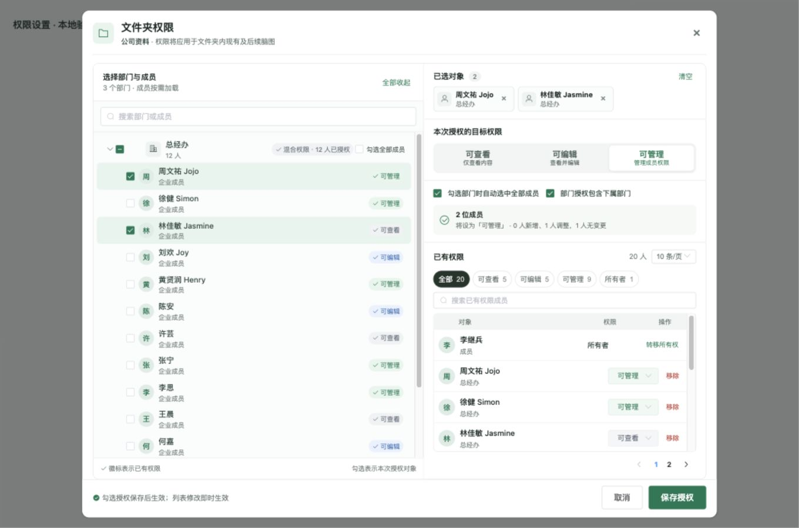
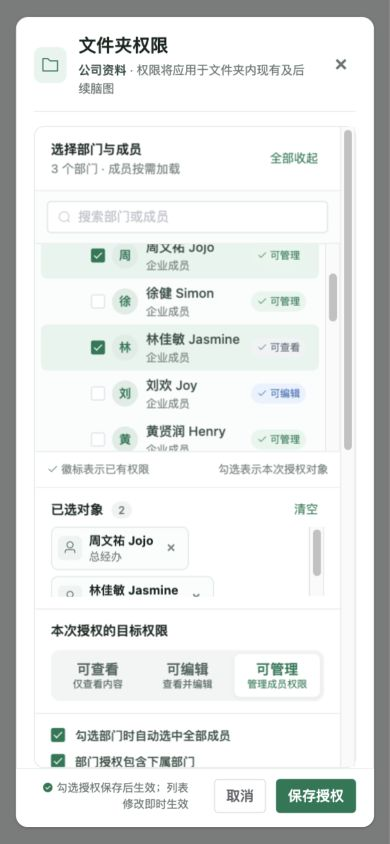
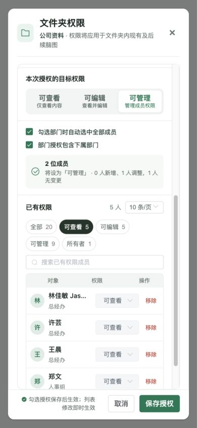

# 文件夹与文件权限弹窗验收

日期：2026-10-14。基于主分支 `b9fe8b28`，分支 `fix/permission-dialog-experience`。

## 实现范围

保留现有左右双栏、组织树、部门选择选项和底部保存。使用现有 Vue 2、Element UI 和项目绿色样式，没有新增依赖。

- 已授权徽标与本次勾选独立：查看灰色、编辑蓝色、管理绿色；待授权行使用浅绿背景，部门支持半选。
- 已选对象保持紧凑并可滚动；目标权限默认可管理。已有权限按角色显示总人数，搜索与筛选组合，分页在条件变化后复位。
- 勾选不写入权限。保存跳过相同角色、重复成员与所有者；部门批量授权在服务端根据实际覆盖成员跳过无变化项。全部一致时提示无需保存。
- 全选部门后取消某个成员，改为提交剩余成员，避免部门展开再次把该成员加回。关闭包含下属部门时移除自动选中的下属成员，保留明确单独勾选的成员。
- 文件直接授权与文件夹/团队继承来源在列表中显示。继承权限需从来源调整，单独移除直接授权仍保留继承权限。
- 原有文件夹授权模型按部门展开为成员授权，未新增部门 ACL。部门徽标反映已加载成员的汇总，混合角色或未完整加载时不宣称整个部门拥有某一权限。
- 文件补齐真实的 manager 角色及数据库约束迁移、列表/共享/知识库可见性和前端能力识别。文件夹 manager 继承到文件仍是 editor；团队角色语义保持原样。只有所有者可转移所有权，manager 无权授予、修改、删除所有者权限。
- 文件夹批量授权仍仅限所有者；文件夹 manager 保留原有逐人调整权限能力，不可授予 manager。

## 验证结果

| 检查 | 结果 |
| --- | --- |
| 浏览器：独立徽标/Checkbox、默认可管理、部门全选与半选 | 通过 |
| 浏览器：重复授权无请求，混合选择仅提交实际变化用户 | 通过；请求记录只包含需要调整的用户 |
| 浏览器：筛选人数、搜索、分页复位、修改与移除后两侧更新 | 通过 |
| 浏览器：文件可管理授权、继承成员移除保护、团队默认成员 | 通过 |
| 浏览器：加载失败提示、禁止保存 | 通过 |
| 浏览器：1360×900 与 390×844 | 通过；窄屏宽度 358px，无横向溢出，标题和底部按钮固定 |
| 浏览器控制台 | 最终页面无 error/warn |
| 权限组件逻辑回归 | 通过，见下方脚本 |
| PostgreSQL：旧约束迁移、重复启动、角色矩阵、所有权规则、继承与移除、SQL/JS 一致性 | 通过 |
| PostgreSQL：真实批量授权去重与跳过无变化项 | 通过；第二次保存 changed=0，原有相同角色记录时间戳未变 |
| 原有 roomAcl、fileSystem、teamSpace 测试 | 通过；teamSpace 测试补齐主分支已存在的 superAdmin=false 返回字段 |
| 生产构建 | 通过 |
| 改动权限组件、服务、语言文件及验证脚本 ESLint | 通过 |

SopRegistry 仅补齐 manager 的权限能力回退判断。该文件已有 8 个 ESLint 错误，已对比 origin/main 确认数量、位置相同，本次未增加错误。构建有既有体积提示。

浏览器使用的是生产组件和生产 service 的隔离内存接口；PostgreSQL 检查使用专用本地测试库，并在事务结束后回滚。以上不是线上企业微信通讯录或真实用户权限的验收，未改动线上数据、未部署。

## 可复现检查

从仓库根目录运行：

```sh
node web/scripts/verifyPermissionDialog.cjs
node simple-mind-map/test/roomAcl.test.js
node simple-mind-map/test/fileSystem.test.js
node simple-mind-map/test/teamSpace.test.js
# 显式指定可丢弃的 PostgreSQL 测试库：
PERMISSION_TEST_DISPOSABLE=1 PGHOST=127.0.0.1 PGPORT=15439 PGDATABASE=mindmap_preview PGUSER=preview PGPASSWORD=preview-local MIND_MAP_SKIP_ROOT_ENV=1 node scripts/verifyPermissionAcl.cjs
node web/scripts/permissionDialogDemo.cjs
```

最后一条启动隔离组件验证页 `http://127.0.0.1:4322/`。完整项目开发页在 `http://127.0.0.1:4320/`，本地协作服务使用专用测试库。






